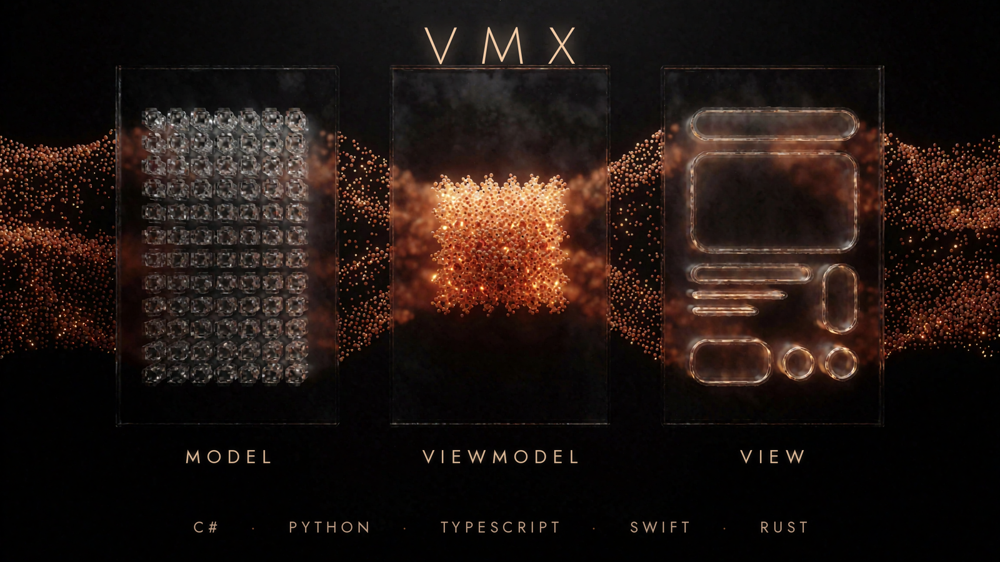
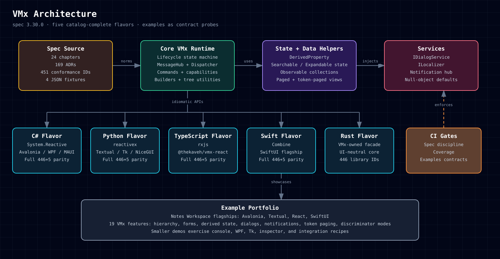
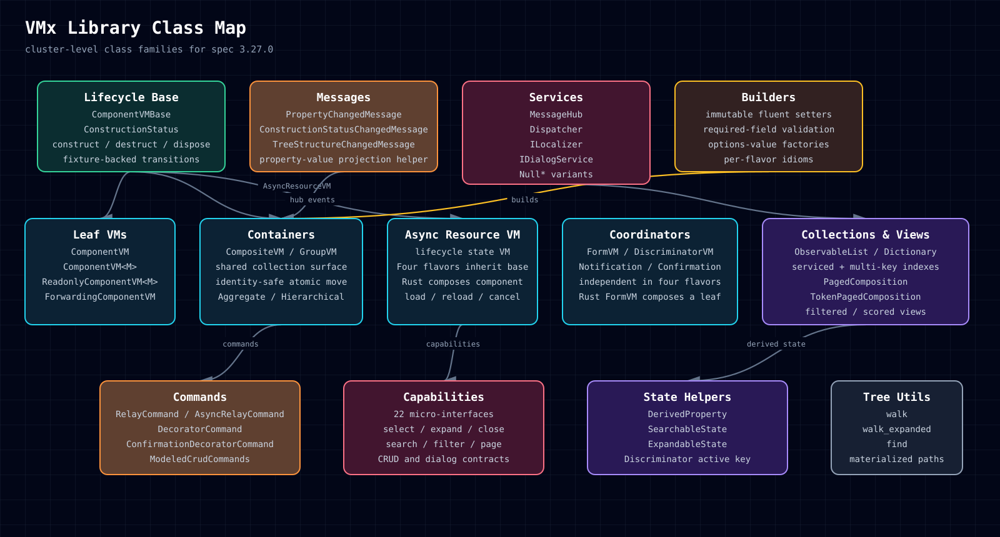

<p align="center">
  
</p>

<h1 align="center">VMx</h1>

<!-- vmx-opener:start -->

<p align="center"><strong>One specification. Five idiomatic flavors. Predictable MVVM behavior across UI stacks.</strong></p>

<p align="center">VMx is a UI-neutral MVVM framework for building viewmodel trees with an explicit lifecycle, a message hub, commands, and observable collections. One language-neutral specification defines its behavior, and the C#, Python, TypeScript, Swift, and Rust flavors implement it in their own language idioms.</p>

<!-- vmx-opener:end -->

<p align="center">
  <strong>Language builds:</strong><br>
  <a href="https://github.com/thekaveh/VMx/actions/workflows/csharp.yml"></a>
  <a href="https://github.com/thekaveh/VMx/actions/workflows/python.yml"></a>
  <a href="https://github.com/thekaveh/VMx/actions/workflows/typescript.yml"></a>
  <a href="https://github.com/thekaveh/VMx/actions/workflows/swift.yml"></a>
  <a href="https://github.com/thekaveh/VMx/actions/workflows/rust.yml"></a>
</p>

<p align="center">
  <strong>Quality gates:</strong><br>
  <a href="https://github.com/thekaveh/VMx/actions/workflows/conformance.yml"></a>
  <a href="https://github.com/thekaveh/VMx/actions/workflows/spec-discipline.yml"></a>
  <a href="https://github.com/thekaveh/VMx/actions/workflows/examples-contract-checks.yml"></a>
  <a href="https://github.com/thekaveh/VMx/actions/workflows/docs.yml"></a>
  <a href="https://github.com/thekaveh/VMx/actions/workflows/security-audit.yml"></a>
</p>

<p align="center">
  <strong>Delivery:</strong><br>
  <a href="https://github.com/thekaveh/VMx/actions/workflows/release.yml"></a>
  <a href="LICENSE"></a>
</p>

## Contents

1. [Overview](#1-overview)
1. [Availability](#2-availability)
1. [Getting started](#3-getting-started)
   - 3.1 [Install](#31-install)
   - 3.2 [First steps](#32-first-steps)
   - 3.3 [Examples](#33-examples)
1. [Architecture](#4-architecture)
   - 4.1 [Architecture diagram](#41-architecture-diagram)
   - 4.2 [Class diagram](#42-class-diagram)
1. [Flavors](#5-flavors)
1. [Versioning and conformance](#6-versioning-and-conformance)
   - 6.1 [SemVer policy](#61-semver-policy)
   - 6.2 [Spec and flavor compatibility](#62-spec-and-flavor-compatibility)
   - 6.3 [Conformance catalog](#63-conformance-catalog)
1. [Repository layout](#7-repository-layout)
   - 7.1 [Documentation map](#71-documentation-map)
1. [Contributing](#8-contributing)
1. [License](#9-license)

## 1. Overview

VMx gives an application a viewmodel layer with an explicit lifecycle. Every
viewmodel moves through one state machine for construction, destruction, and
disposal, and parents own their children. Property and lifecycle changes travel
over a message hub. Commands, collections, forms, and paging helpers build on
the same contract. The core makes no assumption about the UI: the
[integration recipes](docs/content/integration/index.md) bind it to WPF,
Avalonia, MAUI, Textual, NiceGUI, Tkinter, React, Vue, Svelte, SolidJS, and
SwiftUI.

One language-neutral specification in [`spec/`](spec/README.md) defines the
behavior. The C#, Python, TypeScript, Swift, and Rust flavors implement it with
each language's naming and concurrency idioms (ADR-0006), and a shared
conformance catalog keeps them aligned.
[Core Concepts](docs/content/core-concepts.md) summarizes the framework
surface.

## 2. Availability

Python, TypeScript, and the React adapter install from PyPI and npm. Swift
resolves through SwiftPM from the repository's Git tags. C# and Rust are
complete in source but not yet published, so a project uses them from a VMx
checkout until their first registry release.

| Flavor        | Public package                                                                                  | Source line |
| ------------- | ----------------------------------------------------------------------------------------------- | ----------- |
| Python        | [`vmx` 3.23.0](https://pypi.org/project/vmx/3.23.0/) on PyPI                                    | 3.30.0      |
| Swift         | [`VMx` 3.24.0](https://github.com/thekaveh/VMx/releases/tag/swift-v3.24.0) via SwiftPM          | 4.0.0       |
| TypeScript    | [`@thekaveh/vmx` 3.30.0](https://www.npmjs.com/package/@thekaveh/vmx/v/3.30.0) on npm           | 3.31.0      |
| React adapter | [`@thekaveh/vmx-react` 0.1.1](https://www.npmjs.com/package/@thekaveh/vmx-react/v/0.1.1) on npm | 0.1.3       |
| C#            | Not yet published to NuGet                                                                      | 3.30.0      |
| Rust          | Not yet published to crates.io                                                                  | 0.37.0      |

A source line can be ahead of its public package. The
[`compatibility-matrix.md`](compatibility-matrix.md) ledger records which
releases implement which spec version.

## 3. Getting started

### 3.1 Install

Run these commands from your own project directory.

**Python** (PyPI):

```bash
pip install vmx
# or
uv add vmx
```

**Swift** (SwiftPM) — add the package to `Package.swift` and depend on
`.product(name: "VMx", package: "vmx")`:

```swift
.package(url: "https://github.com/thekaveh/VMx.git", from: "3.24.0")
```

**TypeScript** (npm), with the optional official React bindings:

```bash
npm install @thekaveh/vmx rxjs
npm install @thekaveh/vmx-react react use-sync-external-store
```

To try an unreleased TypeScript source line, pack the sources as described in
[Installation](docs/content/installation.md).

C# and Rust install from a source checkout. Clone VMx beside your project
first:

```bash
git clone https://github.com/thekaveh/VMx.git ../VMx
```

**C#** (source checkout; `dotnet add package VMx` applies after the first
NuGet release):

```bash
dotnet add MyApp.csproj reference ../VMx/langs/csharp/src/VMx/VMx.csproj
```

**Rust** (source checkout; crates.io release pending):

```bash
cargo add vmx-rs --path ../VMx/langs/rust
```

[Installation](docs/content/installation.md) lists every install option per
flavor, including source checkouts, with minimum runtimes and upgrade notes.

### 3.2 First steps

[Quickstart](docs/content/getting-started/index.md) builds the same small tree
in every flavor: a message hub and dispatcher, two leaf `ComponentVM` tabs, and
a selectable `CompositeVM` that owns them. The per-flavor guides continue from
there:

- [C#](docs/content/getting-started/csharp.md) — a modeled
  `ComponentVM<UserModel>`, a `RelayCommand`, and a `CompositeVM<TabVM>`.
- [Python](docs/content/getting-started/python.md) — the same shape with the
  snake_case API and immediate or asyncio dispatchers.
- [TypeScript](docs/content/getting-started/typescript.md) — the camelCase API,
  ESM imports, and rxjs-backed observables.
- [Swift](docs/content/getting-started/swift.md) — the camelCase API and
  Combine-backed publishers.
- [Rust](docs/content/getting-started/rust.md) — `ComponentVm`,
  `RelayCommand`, and a selectable `CompositeVm`, with
  [`langs/rust/README.md`](langs/rust/README.md) for crate commands.

### 3.3 Examples

Run these commands from the root of a VMx checkout.

Four flagship Notes Workspace apps implement one shared scenario covering
**19 distinct VMx features** in their host UI; the
[parity matrix](examples/notes-showcase-parity.md) maps each feature to each
app. A Rust-native Ratatui showcase keeps a pure VMx view-model layer with its
own smaller scenario.

- [Avalonia](examples/csharp/avalonia/NotesShowcase/) (.NET 8):
  `dotnet run --project examples/csharp/avalonia/NotesShowcase`
- [Textual](examples/python/textual/notes_showcase/) (terminal UI):
  `uv run --project examples/python/textual/notes_showcase python -m notes_showcase`
- [React](examples/typescript/react/notes-showcase/) (React 19 + Vite):
  `npm --prefix examples/typescript/react/notes-showcase ci`, then
  `npm --prefix examples/typescript/react/notes-showcase run dev`
- [SwiftUI](examples/swift/notes-showcase/) (macOS with Xcode), scenario
  tests: `swift test --package-path examples/swift/notes-showcase`
- [Ratatui](examples/rust/tui/notes-showcase/) (Rust terminal UI):
  `cargo run --locked --manifest-path examples/rust/tui/notes-showcase/Cargo.toml -- --smoke`

Smaller demos:

- [`examples/csharp/console/HelloVMx/`](examples/csharp/console/HelloVMx/) — console.
- [`examples/csharp/wpf/TodoApp/`](examples/csharp/wpf/TodoApp/) — WPF + MVVM
  (Windows only).
- [`examples/python/console/hello_vmx/`](examples/python/console/hello_vmx/) — console.
- [`examples/python/tk/todo_app/`](examples/python/tk/todo_app/) — Tkinter
  MVVM.
- [`examples/python/textual/inspector/`](examples/python/textual/inspector/) —
  Textual TUI inspector that introspects any VMx tree using
  `vmx.tree.walk`.
- [`examples/python/nicegui/notes_showcase/`](examples/python/nicegui/notes_showcase/) —
  NiceGUI web page over the Textual Notes-Showcase's view-models.
- [`examples/typescript/console/hello-vmx/`](examples/typescript/console/hello-vmx/) — minimal
  Node script.
- [`examples/rust/console/hello-vmx/`](examples/rust/console/hello-vmx/) —
  minimal Cargo console demo using `ComponentVm` and `RelayCommand`.

## 4. Architecture

### 4.1 Architecture diagram



Lifecycle validation anchors every VM family while services and builders remain
replaceable around that invariant. Optional decorators and capabilities compose
over the same messages, commands, and collection contracts, so host integrations
do not need to alter the core state machine.
[System Architecture](docs/content/architecture/system-architecture.md)
describes each layer.

### 4.2 Class diagram

A cluster-level map of the principal library families and their relationships.



`ComponentVM`, the container families, and `AsyncResourceVM` share the
lifecycle base contract; Rust expresses these relationships through component
composition. In the object-oriented flavors, `FormVM`, `DiscriminatorVM`,
`NotificationVM`, and `ConfirmationVM` are independent coordinators. Rust's
`FormVM` composes a component leaf. The spec chapters and ADRs hold the member
contracts, and the [Architecture Map](docs/content/architecture/index.md)
walks the full diagram set.

## 5. Flavors

| Flavor     | Naming idiom       | Reactive primitive          | Guide                                           |
| ---------- | ------------------ | --------------------------- | ----------------------------------------------- |
| C#         | PascalCase         | System.Reactive             | [C#](docs/content/flavors/csharp.md)            |
| Python     | snake_case         | reactivex                   | [Python](docs/content/flavors/python.md)        |
| TypeScript | camelCase          | rxjs                        | [TypeScript](docs/content/flavors/typescript.md) |
| Swift      | camelCase          | Combine                     | [Swift](docs/content/flavors/swift.md)          |
| Rust       | snake_case methods | VMx-owned hot-stream facade | [Rust](docs/content/flavors/rust.md)            |

The normative conceptual shape and observable behavior are shared across
flavors, with intentional flavor idioms documented by ADR. Each flavor guide
covers its package, platform floors, and host-integration pointers; the React
bindings ship as the `@thekaveh/vmx-react` adapter over the TypeScript flavor.

## 6. Versioning and conformance

### 6.1 SemVer policy

The spec and each language flavor version independently in SemVer. Every
flavor package declares the spec version it implements (`MinSpecVersion` in C#,
`__min_spec_version__` in Python, `__minSpecVersion__` in TypeScript,
`VMxVersion.minSpecVersion` in Swift, `MIN_SPEC_VERSION` in Rust). A spec major
bump triggers a major bump in every active flavor. A spec minor bump only adds
or clarifies normative behavior, and each flavor ships it as a minor bump.

A flavor also takes a major bump for its own source-breaking change, even when
the spec bump is minor. ADR-0009 records the narrow 3.x exceptions that ship a
source break in a minor version.

### 6.2 Spec and flavor compatibility

Every flavor's source line implements spec 3.30.0.
[`compatibility-matrix.md`](compatibility-matrix.md) is the canonical ledger of
released versions and the spec version each implements.

### 6.3 Conformance catalog

`spec/` holds 24 chapters, the ADRs indexed in
[`spec/ADRs/README.md`](spec/ADRs/README.md), 4 JSON fixtures, and the
conformance catalog in `spec/12-conformance.md`. All five flavors implement
every library conformance ID in that catalog, and the four UI-backed flagship
apps cover the additional `THEME-00x` scenario IDs. Rust has no UI scenario
suite yet.
`tools/check-conformance-coverage.py` enforces full catalog coverage, and
[Specification & Conformance](docs/content/specification-conformance.md)
describes the suites and test markers.

Run the coverage check from the root of a VMx checkout:

```bash
# Verify all catalog-complete flavors are at full catalog coverage
uv run --project langs/python python tools/check-conformance-coverage.py \
    --require csharp --require python --require typescript --require swift --require rust

# Report all registered flavors
python3 tools/check-conformance-coverage.py
```

## 7. Repository layout

```
.
├── spec/                  language-neutral specification (source of truth)
│   ├── 00-overview.md ... 23-async-resource-vm.md  numbered chapters
│   ├── ADRs/              architecture decision records (indexed in ADRs/README.md)
│   ├── fixtures/          JSON test inputs shared across flavors
│   ├── schemas/           versioned supporting machine contracts
│   ├── proposals/         mostly historical; scenario contracts may be normative
│   ├── HISTORY.md         spec release history
│   └── VERSION            spec SemVer
├── langs/
│   ├── csharp/            VMx (NuGet) + VMx.Extensions.DependencyInjection + VMx.Notifications
│   ├── python/            vmx (PyPI)
│   ├── typescript/        @thekaveh/vmx (npm)
│   ├── swift/             VMx Swift package sources and tests
│   └── rust/              vmx-rs crate
├── Package.swift          public SwiftPM entry point over langs/swift
├── packages/
│   ├── react/             @thekaveh/vmx-react React adapter (npm)
│   └── react-18-deps/     React 18 dependency lock for the adapter checks
├── examples/              runnable example apps per flavor
├── starters/              application starter templates
├── benchmarks/            benchmark harnesses and committed baselines
├── docs/
│   ├── content/           guide pages, also published as the site and wiki
│   ├── maintenance/       maintenance ledgers and audit records
│   └── audit/             historical documentation audit reports
├── tools/                 cross-cutting check and generation scripts
├── scripts/docs/          documentation build and check scripts
├── tests/docs/            documentation contract tests
├── assets/                poster and architecture/class diagrams
├── .github/               issue/PR templates + CI workflows
└── compatibility-matrix.md
```

### 7.1 Documentation map

The [documentation landing page](docs/content/index.md) links the installation,
quickstart, architecture, core-concepts, and integration guides. The other
guide sections are [framework primitives](docs/content/primitives/index.md),
[language flavors](docs/content/flavors/index.md),
[examples](docs/content/examples/index.md), and
[contributing and releases](docs/content/contributing-releases.md). Each
package also has its own documents:

| Package       | Overview and commands                     | Release history                                 | Release runbook                                 |
| ------------- | ----------------------------------------- | ----------------------------------------------- | ----------------------------------------------- |
| C#            | [README](langs/csharp/README.md)          | [CHANGELOG](langs/csharp/CHANGELOG.md)          | [RELEASING](langs/csharp/RELEASING.md)          |
| Python        | [README](langs/python/README.md)          | [CHANGELOG](langs/python/CHANGELOG.md)          | [RELEASING](langs/python/RELEASING.md)          |
| TypeScript    | [README](langs/typescript/README.md)      | [CHANGELOG](langs/typescript/CHANGELOG.md)      | [RELEASING](langs/typescript/RELEASING.md)      |
| Swift         | [README](langs/swift/README.md)           | [CHANGELOG](langs/swift/CHANGELOG.md)           | [RELEASING](langs/swift/RELEASING.md)           |
| Rust          | [README](langs/rust/README.md)            | [CHANGELOG](langs/rust/CHANGELOG.md)            | [RELEASING](langs/rust/RELEASING.md)            |
| React adapter | [README](packages/react/README.md)        | [CHANGELOG](packages/react/CHANGELOG.md)        | [RELEASING](packages/react/RELEASING.md)        |

[`SECURITY.md`](SECURITY.md) lists the supported versions and tells you how to
report a vulnerability. [`CODE_OF_CONDUCT.md`](CODE_OF_CONDUCT.md) holds the
community guidelines.

## 8. Contributing

See [`CONTRIBUTING.md`](CONTRIBUTING.md) for the spec / ADR / conformance
workflow, per-flavor build instructions, and the documentation and maintainer
records. The repository uses pre-commit hooks (ruff, mdformat, dotnet format,
eslint); install them with `pre-commit install`.

## 9. License

Apache-2.0 — see [`LICENSE`](LICENSE) and [`NOTICE`](NOTICE).
