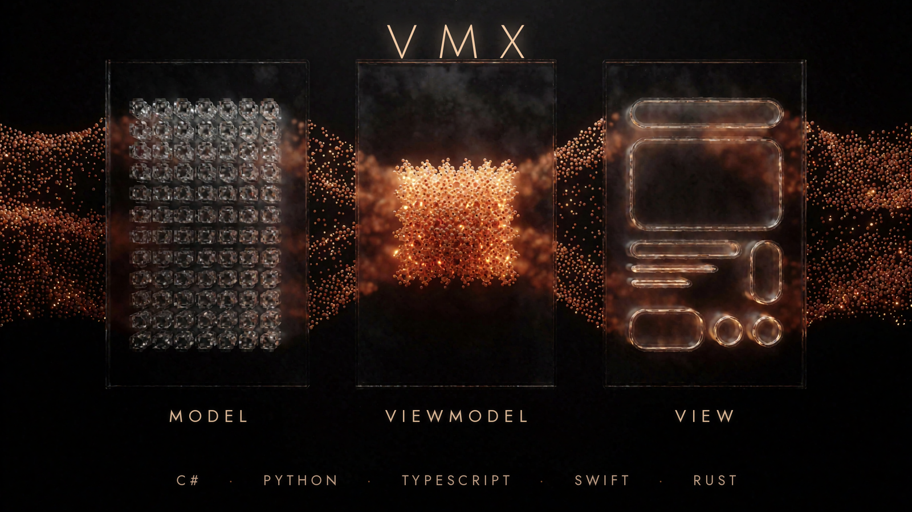
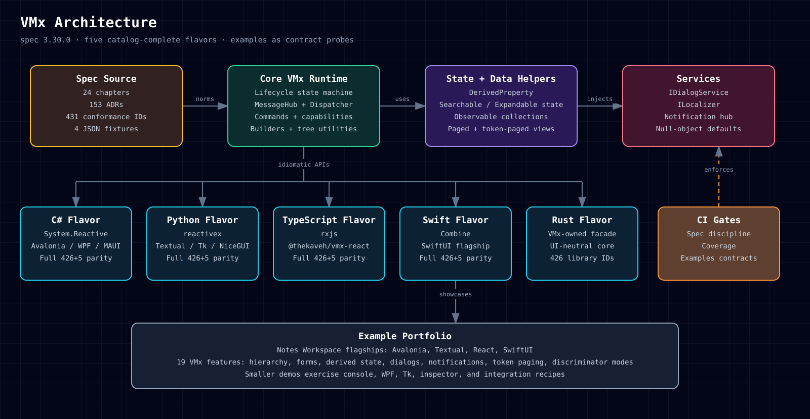
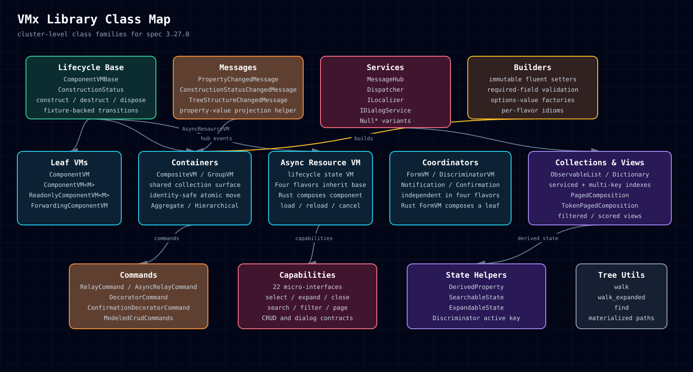

<p align="center">
  
</p>

<h1 align="center">VMx</h1>

<!-- vmx-opener:start -->

<p align="center"><strong>One specification. Five idiomatic flavors. Predictable MVVM behavior across UI stacks.</strong></p>

<p align="center">VMx is a UI-neutral MVVM framework for building viewmodel trees with an explicit lifecycle, a message hub, commands, and observable collections. One language-neutral specification defines its behavior, and the C#, Python, TypeScript, Swift, and Rust flavors implement it in their own language idioms.</p>

<!-- vmx-opener:end -->

<p align="center">
  <strong>Language builds:</strong><br>
  <a href="https://github.com/thekaveh/VMx/actions/workflows/csharp.yml"></a>
  <a href="https://github.com/thekaveh/VMx/actions/workflows/python.yml"></a>
  <a href="https://github.com/thekaveh/VMx/actions/workflows/typescript.yml"></a>
  <a href="https://github.com/thekaveh/VMx/actions/workflows/swift.yml"></a>
  <a href="https://github.com/thekaveh/VMx/actions/workflows/rust.yml"></a>
</p>

<p align="center">
  <strong>Quality gates:</strong><br>
  <a href="https://github.com/thekaveh/VMx/actions/workflows/conformance.yml"></a>
  <a href="https://github.com/thekaveh/VMx/actions/workflows/spec-discipline.yml"></a>
  <a href="https://github.com/thekaveh/VMx/actions/workflows/examples-contract-checks.yml"></a>
  <a href="https://github.com/thekaveh/VMx/actions/workflows/docs.yml"></a>
  <a href="https://github.com/thekaveh/VMx/actions/workflows/security-audit.yml"></a>
</p>

<p align="center">
  <strong>Delivery:</strong><br>
  <a href="https://github.com/thekaveh/VMx/actions/workflows/release.yml"></a>
  <a href="LICENSE"></a>
</p>

## Contents

1. [Overview](#1-overview)
1. [Availability](#2-availability)
1. [Getting started](#3-getting-started)
   - 3.1 [Install](#31-install)
   - 3.2 [First steps](#32-first-steps)
   - 3.3 [Examples](#33-examples)
1. [Architecture](#4-architecture)
   - 4.1 [Architecture diagram](#41-architecture-diagram)
   - 4.2 [Class diagram](#42-class-diagram)
1. [Flavors](#5-flavors)
1. [Versioning and conformance](#6-versioning-and-conformance)
   - 6.1 [SemVer policy](#61-semver-policy)
   - 6.2 [Spec and flavor compatibility](#62-spec-and-flavor-compatibility)
   - 6.3 [Conformance catalog](#63-conformance-catalog)
1. [Repository layout](#7-repository-layout)
   - 7.1 [Documentation map](#71-documentation-map)
1. [Contributing](#8-contributing)
1. [License](#9-license)

## 1. Overview

VMx gives an application a viewmodel layer with an explicit lifecycle. Every
viewmodel is constructed, destructed, and disposed through one state machine;
parents own their children; property and lifecycle changes travel over a
message hub; and commands, collections, forms, and paging helpers build on the
same contract. The core makes no assumption about the UI: the
[integration recipes](docs/content/integration/index.md) bind it to WPF,
Avalonia, MAUI, Textual, NiceGUI, Tkinter, React, Vue, Svelte, SolidJS, and
SwiftUI.

One language-neutral specification in [`spec/`](spec/README.md) defines the
behavior. The C#, Python, TypeScript, Swift, and Rust flavors implement it with
each language's naming and concurrency idioms (ADR-0006), and a shared
conformance catalog keeps them aligned.
[Core Concepts](docs/content/core-concepts.md) lists the complete framework
surface.

## 2. Availability

Python, Swift, TypeScript, and the React adapter install from public registries.
C# and Rust are complete in source but not yet published, so a project uses
them from a VMx checkout until their first registry release.

| Flavor        | Public package                                                                                  | Source line |
| ------------- | ----------------------------------------------------------------------------------------------- | ----------- |
| Python        | [`vmx` 3.23.0](https://pypi.org/project/vmx/3.23.0/) on PyPI                                    | v3.30.0     |
| Swift         | [`VMx` 3.24.0](https://github.com/thekaveh/VMx/releases/tag/swift-v3.24.0) via SwiftPM          | v3.31.0     |
| TypeScript    | [`@thekaveh/vmx` 3.30.0](https://www.npmjs.com/package/@thekaveh/vmx/v/3.30.0) on npm           | v3.31.0     |
| React adapter | [`@thekaveh/vmx-react` 0.1.1](https://www.npmjs.com/package/@thekaveh/vmx-react/v/0.1.1) on npm | v0.1.2      |
| C#            | Not yet published to NuGet                                                                      | v3.30.0     |
| Rust          | Not yet published to crates.io                                                                  | v0.36.0     |

A source line can be ahead of its public package. The
[`compatibility-matrix.md`](compatibility-matrix.md) ledger records which
releases implement which spec version.

## 3. Getting started

### 3.1 Install

Run these commands from your own project directory. The source-checkout
commands assume VMx is cloned beside that project:

```bash
git clone https://github.com/thekaveh/VMx.git ../VMx
```

**Python** (PyPI):

```bash
pip install vmx
# or
uv add vmx
```

**Swift** (SwiftPM) — add the package to `Package.swift` and depend on
`.product(name: "VMx", package: "vmx")`:

```swift
.package(url: "https://github.com/thekaveh/VMx.git", from: "3.24.0")
```

**C#** (source checkout; `dotnet add package VMx` applies after the first
NuGet release):

```bash
dotnet add MyApp.csproj reference ../VMx/langs/csharp/src/VMx/VMx.csproj
```

**TypeScript** (npm), with the optional official React bindings:

```bash
npm install @thekaveh/vmx rxjs
npm install @thekaveh/vmx-react react use-sync-external-store
```

To try an unreleased TypeScript source line, pack the sources as described in
[Installation](docs/content/installation.md).

**Rust** (source checkout; crates.io release pending):

```bash
cargo add vmx-rs --path ../VMx/langs/rust
```

[Installation](docs/content/installation.md) lists every install option per
flavor, including source checkouts, with minimum runtimes and upgrade notes.

### 3.2 First steps

[Quickstart](docs/content/getting-started/index.md) builds the same small tree
in every flavor: a message hub and dispatcher, two leaf `ComponentVM` tabs, and
a selectable `CompositeVM` that owns them. The per-flavor guides continue from
there:

- [C#](docs/content/getting-started/csharp.md) — a modeled
  `ComponentVM<UserModel>`, a `RelayCommand`, and a `CompositeVM<TabVM>`.
- [Python](docs/content/getting-started/python.md) — the same shape with the
  snake_case API and immediate or asyncio dispatchers.
- [TypeScript](docs/content/getting-started/typescript.md) — the camelCase API,
  ESM imports, and rxjs-backed observables.
- [Swift](docs/content/getting-started/swift.md) — the camelCase API and
  Combine-backed publishers.
- [Rust](docs/content/getting-started/rust.md) — `ComponentVm`,
  `RelayCommand`, and a selectable `CompositeVm`, with
  [`langs/rust/README.md`](langs/rust/README.md) for crate commands.

### 3.3 Examples

Run these commands from the root of a VMx checkout.

Four flagship Notes Workspace apps implement one shared scenario covering
**19 distinct VMx features** in their host UI; the
[parity matrix](examples/notes-showcase-parity.md) maps each feature to each
app. A Rust-native Ratatui showcase keeps a pure VMx view-model layer with its
own smaller scenario.

- [Avalonia](examples/csharp/avalonia/NotesShowcase/) (.NET 8):
  `dotnet run --project examples/csharp/avalonia/NotesShowcase`
- [Textual](examples/python/textual/notes_showcase/) (terminal UI):
  `uv run --project examples/python/textual/notes_showcase python -m notes_showcase`
- [React](examples/typescript/react/notes-showcase/) (React 19 + Vite):
  `npm --prefix examples/typescript/react/notes-showcase ci`, then
  `npm --prefix examples/typescript/react/notes-showcase run dev`
- [SwiftUI](examples/swift/notes-showcase/) (macOS with Xcode), scenario
  tests: `swift test --package-path examples/swift/notes-showcase`
- [Ratatui](examples/rust/tui/notes-showcase/) (Rust terminal UI):
  `cargo run --locked --manifest-path examples/rust/tui/notes-showcase/Cargo.toml -- --smoke`

Smaller demos:

- [`examples/csharp/console/HelloVMx/`](examples/csharp/console/HelloVMx/) — console.
- [`examples/csharp/wpf/TodoApp/`](examples/csharp/wpf/TodoApp/) — WPF + MVVM
  (Windows only).
- [`examples/python/console/hello_vmx/`](examples/python/console/hello_vmx/) — console.
- [`examples/python/tk/todo_app/`](examples/python/tk/todo_app/) — Tkinter
  MVVM.
- [`examples/python/textual/inspector/`](examples/python/textual/inspector/) —
  Textual TUI inspector that introspects any VMx tree using
  `vmx.tree.walk`.
- [`examples/python/nicegui/notes_showcase/`](examples/python/nicegui/notes_showcase/) —
  NiceGUI web page over the Textual Notes-Showcase's view-models.
- [`examples/typescript/console/hello-vmx/`](examples/typescript/console/hello-vmx/) — minimal
  Node script.
- [`examples/rust/console/hello-vmx/`](examples/rust/console/hello-vmx/) —
  minimal Cargo console demo using `ComponentVm` and `RelayCommand`.

## 4. Architecture

### 4.1 Architecture diagram



Lifecycle validation anchors every VM family while services and builders remain
replaceable around that invariant. Optional decorators and capabilities compose
over the same messages, commands, and collection contracts, so host integrations
do not need to alter the core state machine.
[System Architecture](docs/content/architecture/system-architecture.md)
describes each layer.

### 4.2 Class diagram

A cluster-level map of the principal library families and their relationships.



`ComponentVM`, the container families, and `AsyncResourceVM` participate in
the lifecycle base contract; Rust expresses relevant relationships through
component composition. `FormVM`, `DiscriminatorVM`, `NotificationVM`, and
`ConfirmationVM` are independent coordinators in the object-oriented flavors,
with Rust's `FormVM` composing a component leaf. The remaining clusters cover
commands, capabilities, services, messages, builders, collections, paging,
state helpers, and tree utilities. The exhaustive member contracts live in the
linked spec chapters and ADRs, and the
[Architecture Map](docs/content/architecture/index.md) walks the full diagram
set.

## 5. Flavors

| Flavor     | Naming idiom       | Reactive primitive          | Guide                                           |
| ---------- | ------------------ | --------------------------- | ----------------------------------------------- |
| C#         | PascalCase         | System.Reactive             | [C#](docs/content/flavors/csharp.md)            |
| Python     | snake_case         | reactivex                   | [Python](docs/content/flavors/python.md)        |
| TypeScript | camelCase          | rxjs                        | [TypeScript](docs/content/flavors/typescript.md) |
| Swift      | camelCase          | Combine                     | [Swift](docs/content/flavors/swift.md)          |
| Rust       | snake_case methods | VMx-owned hot-stream facade | [Rust](docs/content/flavors/rust.md)            |

The normative conceptual shape and observable behavior are shared across
flavors, with intentional flavor idioms documented by ADR. Each flavor guide
covers its package, platform floors, and host-integration pointers; the React
bindings ship as the `@thekaveh/vmx-react` adapter over the TypeScript flavor.

## 6. Versioning and conformance

### 6.1 SemVer policy

Each language flavor versions independently in SemVer. The spec also versions
independently in SemVer. Every published package declares the spec version it
implements (`MinSpecVersion` in C#, `__min_spec_version__` in Python,
`__minSpecVersion__` in TypeScript, `VMxVersion.minSpecVersion` in Swift,
`MIN_SPEC_VERSION` in Rust). A
spec major bump triggers a major bump in every active flavor; a spec minor bump
is fully backwards compatible and ships in flavors as a minor bump.

### 6.2 Spec and flavor compatibility

Every flavor's source line implements spec 3.30.0.
[`compatibility-matrix.md`](compatibility-matrix.md) is the canonical ledger of
released versions and the spec version each implements.

### 6.3 Conformance catalog

`spec/` holds 24 chapters, 167 ADRs, 4 JSON fixtures, and the conformance
catalog in `spec/12-conformance.md`. All five flavors implement its
444 library conformance IDs, and the four UI-backed flagship apps cover
5 additional THEME scenario IDs, for **449 total**. Rust has no UI scenario
suite yet.
`tools/check-conformance-coverage.py` enforces full catalog coverage, and
[Specification & Conformance](docs/content/specification-conformance.md)
describes the suites and test markers.

Run the coverage check from the root of a VMx checkout:

```bash
# Verify all catalog-complete flavors are at full catalog coverage
uv run --project langs/python python tools/check-conformance-coverage.py \
    --require csharp --require python --require typescript --require swift --require rust

# Report all registered flavors
python3 tools/check-conformance-coverage.py
```

## 7. Repository layout

```
.
├── spec/                  language-neutral specification (source of truth)
│   ├── 00-overview.md ... 23-async-resource-vm.md  (24 chapters)
│   ├── ADRs/              architecture decision records (0001..0167)
│   ├── fixtures/          JSON test inputs shared across flavors
│   ├── schemas/           versioned supporting machine contracts
│   ├── proposals/         mostly historical; scenario contracts may be normative
│   └── VERSION            spec SemVer
├── langs/
│   ├── csharp/            VMx (NuGet) + VMx.Extensions.DependencyInjection + VMx.Notifications
│   ├── python/            vmx (PyPI)
│   ├── typescript/        @thekaveh/vmx (npm)
│   ├── swift/             VMx Swift package (SwiftPM)
│   └── rust/              vmx-rs crate
├── packages/
│   └── react/             @thekaveh/vmx-react React adapter (npm)
├── examples/              runnable example apps per flavor
├── benchmarks/            benchmark harnesses and committed baselines
├── docs/content/getting-started/  per-flavor quickstart tutorials
├── docs/content/integration/      one-page UI-framework integration recipes
├── docs/maintenance/      maintenance run ledgers and audit records
├── tools/                 cross-cutting scripts (conformance coverage)
├── scripts/docs/          documentation build and check scripts
├── tests/docs/            documentation contract tests
├── assets/                architecture + class diagrams, notes-showcase assets
├── .github/               issue/PR templates + CI workflows
└── compatibility-matrix.md
```

### 7.1 Documentation map

This README is the entry point; the documents below add focused detail.

- [`docs/content/index.md`](docs/content/index.md) — canonical documentation
  landing page and overview of the complete VMx documentation set.
- Major documentation sections: [installation](docs/content/installation.md),
  [quickstart](docs/content/getting-started/index.md),
  [core concepts](docs/content/core-concepts.md),
  [architecture](docs/content/architecture/index.md),
  [framework primitives](docs/content/primitives/index.md),
  [language flavors](docs/content/flavors/index.md),
  [examples](docs/content/examples/index.md),
  [integration recipes](docs/content/integration/index.md),
  [specification and conformance](docs/content/specification-conformance.md),
  and [contributing and releases](docs/content/contributing-releases.md).
- [`CONTRIBUTING.md`](CONTRIBUTING.md) — spec / ADR / conformance workflow,
  per-flavor build commands, pre-commit setup. Read before opening a PR.
- [`SECURITY.md`](SECURITY.md) — supported-version table and how to report
  vulnerabilities.
- [`CODE_OF_CONDUCT.md`](CODE_OF_CONDUCT.md) — Contributor-Covenant
  community guidelines.
- [`compatibility-matrix.md`](compatibility-matrix.md) — spec ↔ flavor
  version pairing.
- [`spec/README.md`](spec/README.md) — index of the 24 chapters, 167 ADRs,
  4 fixtures, and the 449-ID conformance catalog.
- [`spec/ADRs/README.md`](spec/ADRs/README.md) — ADR catalogue index.
- [`docs/audit/README.md`](docs/audit/README.md) — index of historical
  documentation audit reports.
- [`docs/maintenance/`](docs/maintenance/) — maintenance ledgers and their
  verification evidence.
- [`docs/assets/diagrams/README.md`](docs/assets/diagrams/README.md) — diagram
  source, regeneration, and validation contract.
- [`docs/content/primitives/disposal-contract.md`](docs/content/primitives/disposal-contract.md)
  — cross-flavor public disposal inventory and post-dispose contract.
- Per-flavor READMEs (status, install, API surface, dev commands):
  [`langs/csharp/README.md`](langs/csharp/README.md),
  [`langs/python/README.md`](langs/python/README.md),
  [`langs/typescript/README.md`](langs/typescript/README.md),
  [`langs/swift/README.md`](langs/swift/README.md),
  [`langs/rust/README.md`](langs/rust/README.md).
- React adapter: [`packages/react/README.md`](packages/react/README.md)
  (usage), [`packages/react/CHANGELOG.md`](packages/react/CHANGELOG.md)
  (release history), and
  [`packages/react/RELEASING.md`](packages/react/RELEASING.md) (npm release
  runbook).
- [`benchmarks/README.md`](benchmarks/README.md) — benchmark method, commands,
  and baselines.
- Per-flavor CHANGELOGs (release history):
  [`langs/csharp/CHANGELOG.md`](langs/csharp/CHANGELOG.md),
  [`langs/python/CHANGELOG.md`](langs/python/CHANGELOG.md),
  [`langs/typescript/CHANGELOG.md`](langs/typescript/CHANGELOG.md),
  [`langs/swift/CHANGELOG.md`](langs/swift/CHANGELOG.md),
  [`langs/rust/CHANGELOG.md`](langs/rust/CHANGELOG.md).
- Per-flavor release runbooks:
  [`langs/csharp/RELEASING.md`](langs/csharp/RELEASING.md) (NuGet),
  [`langs/python/RELEASING.md`](langs/python/RELEASING.md) (PyPI),
  [`langs/typescript/RELEASING.md`](langs/typescript/RELEASING.md) (npm),
  [`langs/swift/RELEASING.md`](langs/swift/RELEASING.md) (SwiftPM tags and
  GitHub Releases), and
  [`langs/rust/RELEASING.md`](langs/rust/RELEASING.md) (crates.io).
- Per-flavor examples READMEs (run instructions):
  [`examples/csharp/README.md`](examples/csharp/README.md),
  [`examples/python/README.md`](examples/python/README.md),
  [`examples/typescript/README.md`](examples/typescript/README.md),
  [`examples/swift/notes-showcase/README.md`](examples/swift/notes-showcase/README.md),
  [`examples/rust/README.md`](examples/rust/README.md).
- [`examples/notes-showcase-parity.md`](examples/notes-showcase-parity.md) —
  cross-flavor parity matrix for all four flagship Notes-Showcase apps
  (Avalonia / Textual / React / SwiftUI), plus hierarchy and VMx-component
  diagrams.
- [`docs/content/integration/index.md`](docs/content/integration/index.md) — one-page
  integration recipes for 11 UI frameworks (WPF, MAUI, Avalonia, Textual,
  NiceGUI, Tkinter, React, Vue, Svelte, SolidJS, SwiftUI). Each recipe
  shows the framework-native binding + lifecycle + dispose pattern.
- [`tools/README.md`](tools/README.md) — conformance-coverage tool and
  cross-cutting scripts.

## 8. Contributing

See [`CONTRIBUTING.md`](CONTRIBUTING.md) for the spec / ADR / conformance
workflow and per-flavor build instructions. The repository uses pre-commit
hooks (ruff, mdformat, dotnet format, eslint); install them with
`pre-commit install`.

## 9. License

Apache-2.0 — see [`LICENSE`](LICENSE) and [`NOTICE`](NOTICE).
