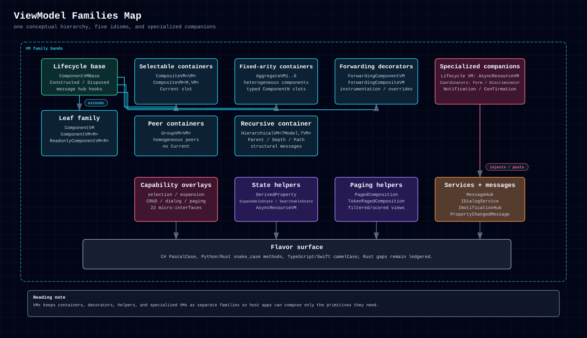
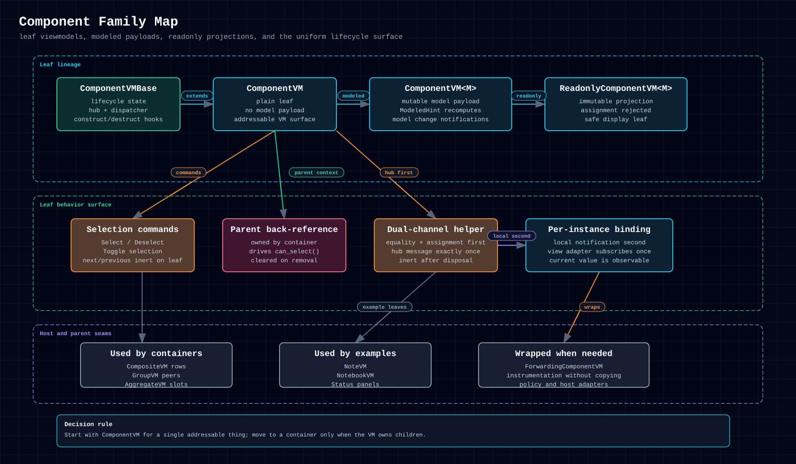
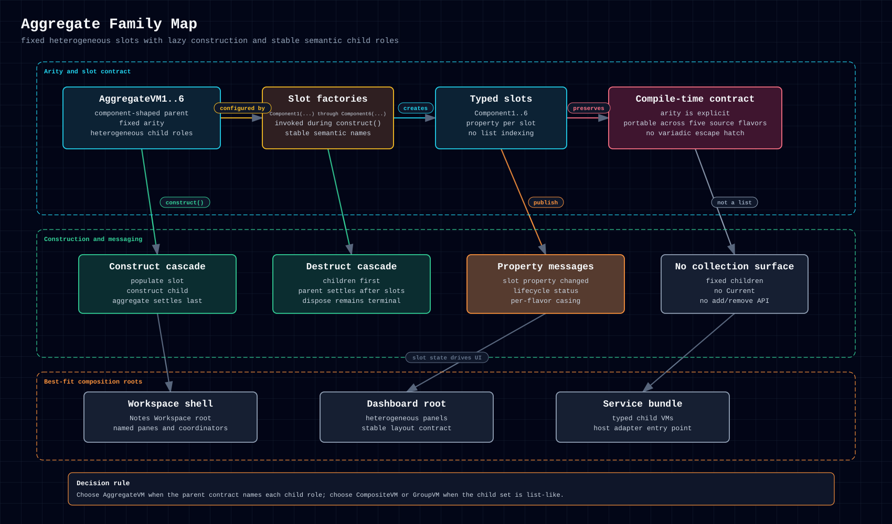
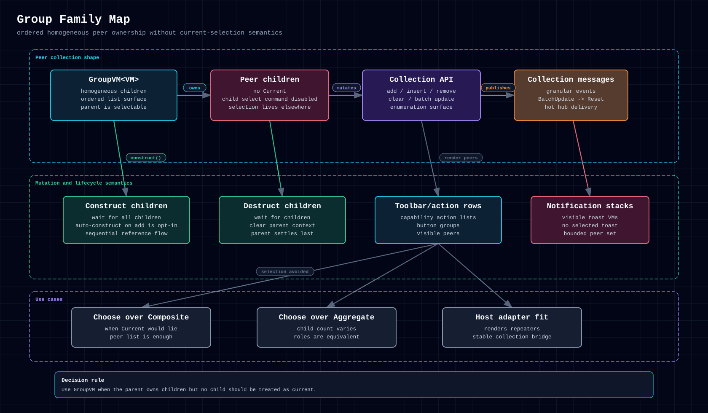
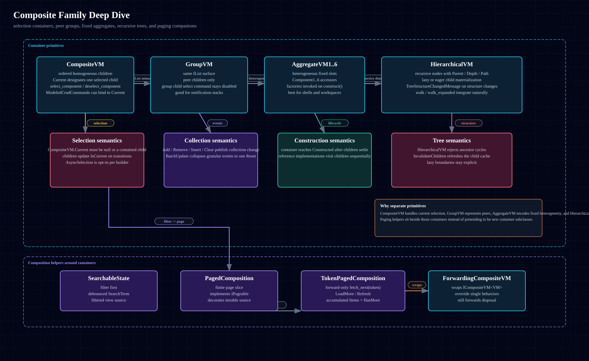
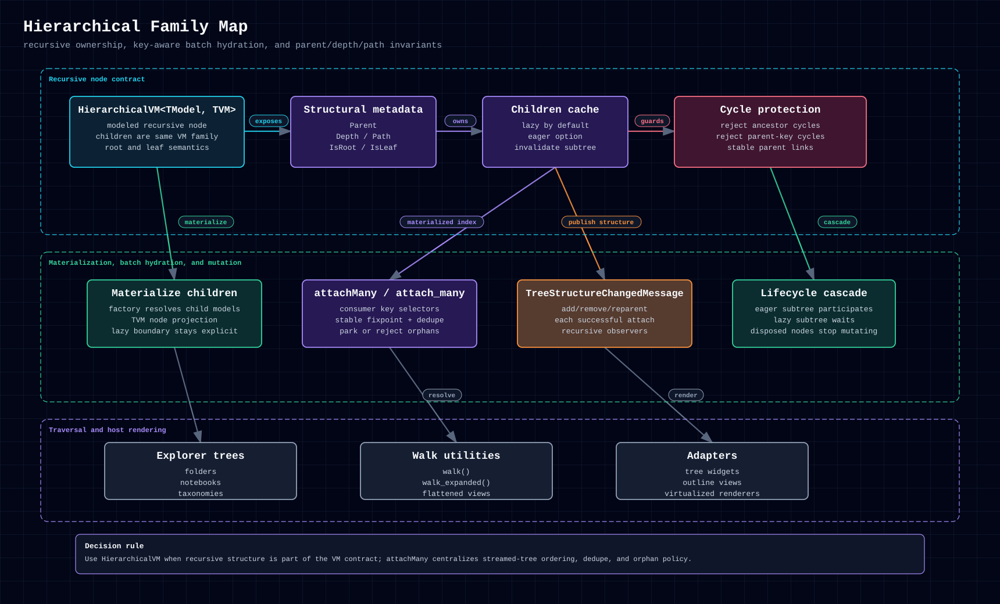
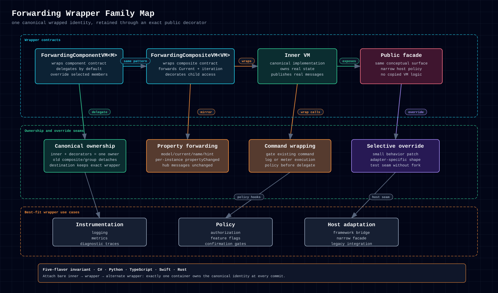
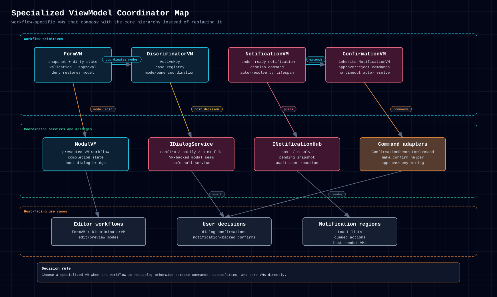
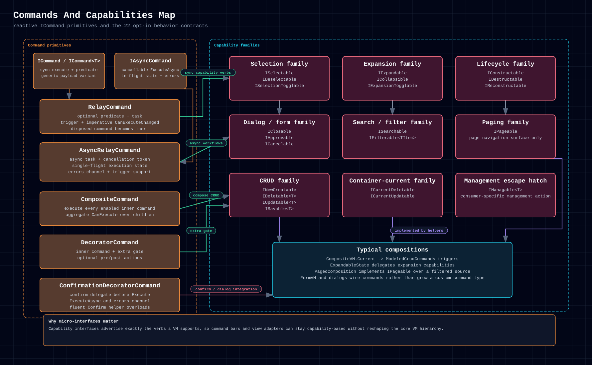
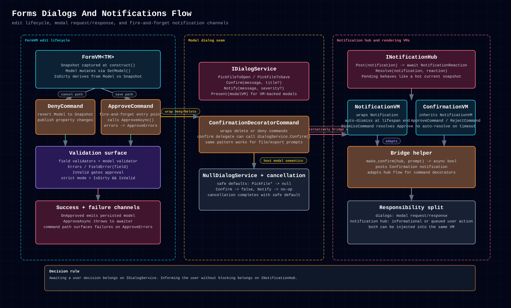

# 5.5. Diagram Gallery

The gallery collects the primitive diagrams in one place. Each diagram links
its exports; use the PNG export to share a diagram.

Other diagrams have their own pages:

- [System Architecture](system-architecture.md),
  [Class Architecture](class-architecture.md), and
  [Lifecycle & Messaging](lifecycle-messaging.md) show the architecture
  diagrams.
- [VM Layer Map](../examples/notes-workspace-vm-layer.md) shows the Notes
  Workspace viewmodel layer.
- [Example Diagram Gallery](../examples/example-diagram-gallery.md) shows one
  diagram for each example app.

## 5.5.1. Primitives

### 5.5.1.1. ViewModel Families Map

  <a href="../../assets/diagrams/viewmodel-families.html">HTML</a>
  &middot;
  <a href="../../assets/diagrams/viewmodel-families.svg">SVG</a>
  &middot;
  <a href="../../assets/diagrams/viewmodel-families.png">PNG</a>

### 5.5.1.2. Component Family Map

  <a href="../../assets/diagrams/component-family.html">HTML</a>
  &middot;
  <a href="../../assets/diagrams/component-family.svg">SVG</a>
  &middot;
  <a href="../../assets/diagrams/component-family.png">PNG</a>

### 5.5.1.3. Aggregate Family Map

  <a href="../../assets/diagrams/aggregate-family.html">HTML</a>
  &middot;
  <a href="../../assets/diagrams/aggregate-family.svg">SVG</a>
  &middot;
  <a href="../../assets/diagrams/aggregate-family.png">PNG</a>

### 5.5.1.4. Group Family Map

  <a href="../../assets/diagrams/group-family.html">HTML</a>
  &middot;
  <a href="../../assets/diagrams/group-family.svg">SVG</a>
  &middot;
  <a href="../../assets/diagrams/group-family.png">PNG</a>

### 5.5.1.5. Composite Family Deep Dive

  <a href="../../assets/diagrams/composite-family.html">HTML</a>
  &middot;
  <a href="../../assets/diagrams/composite-family.svg">SVG</a>
  &middot;
  <a href="../../assets/diagrams/composite-family.png">PNG</a>

### 5.5.1.6. Hierarchical Family Map

  <a href="../../assets/diagrams/hierarchical-family.html">HTML</a>
  &middot;
  <a href="../../assets/diagrams/hierarchical-family.svg">SVG</a>
  &middot;
  <a href="../../assets/diagrams/hierarchical-family.png">PNG</a>

### 5.5.1.7. Forwarding Wrapper Family Map

  <a href="../../assets/diagrams/forwarding-wrapper-family.html">HTML</a>
  &middot;
  <a href="../../assets/diagrams/forwarding-wrapper-family.svg">SVG</a>
  &middot;
  <a href="../../assets/diagrams/forwarding-wrapper-family.png">PNG</a>

### 5.5.1.8. Specialized ViewModel Coordinator Map

  <a href="../../assets/diagrams/specialized-vm-family.html">HTML</a>
  &middot;
  <a href="../../assets/diagrams/specialized-vm-family.svg">SVG</a>
  &middot;
  <a href="../../assets/diagrams/specialized-vm-family.png">PNG</a>

### 5.5.1.9. Commands And Capabilities Map

  <a href="../../assets/diagrams/commands-capabilities.html">HTML</a>
  &middot;
  <a href="../../assets/diagrams/commands-capabilities.svg">SVG</a>
  &middot;
  <a href="../../assets/diagrams/commands-capabilities.png">PNG</a>

### 5.5.1.10. Forms Dialogs And Notifications Flow

  <a href="../../assets/diagrams/forms-dialogs-notifications.html">HTML</a>
  &middot;
  <a href="../../assets/diagrams/forms-dialogs-notifications.svg">SVG</a>
  &middot;
  <a href="../../assets/diagrams/forms-dialogs-notifications.png">PNG</a>

