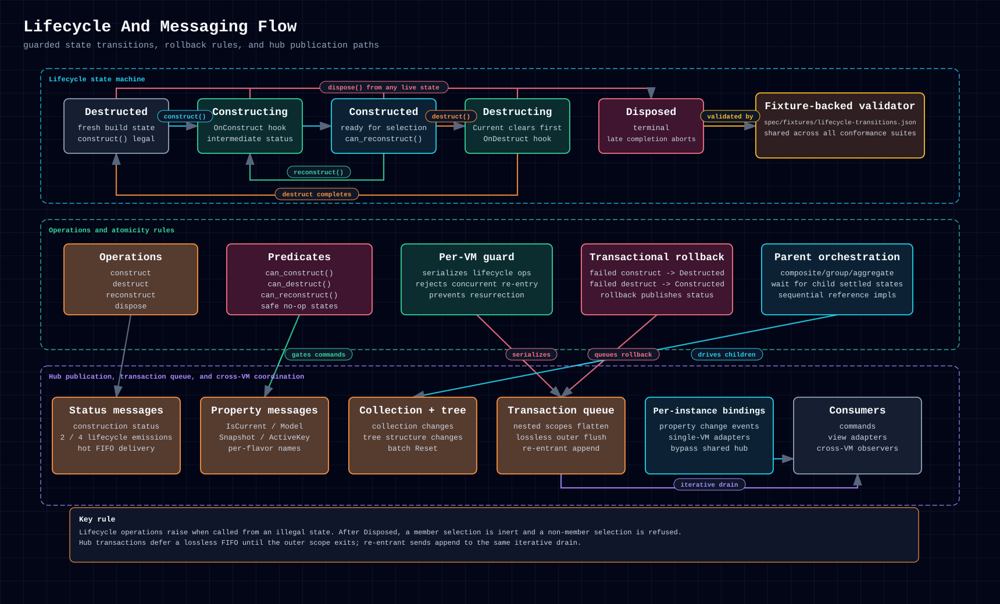

# 5.4. Lifecycle & Messaging

Lifecycle and messaging are the runtime spine of VMx. Construction transitions,
property messages, and collection events are coordinated so parent and child
trees behave predictably across flavors.

  <a href="../../assets/diagrams/lifecycle-messaging.html">Open standalone diagram</a>
  &middot;
  <a href="../../assets/diagrams/lifecycle-messaging.png">PNG</a>

This view is most useful when you need to reason about construct/destruct
ordering, hub notifications, or how state changes propagate across a VM tree.

## 5.4.1. Transition Table

The table gives the result of each lifecycle operation in each state. An arrow
shows the intermediate state before the final state. The table follows the
shared fixture `spec/fixtures/lifecycle-transitions.json`, which every
conformance suite loads.

| From state     | `construct`                | `destruct`               | `reconstruct`                                         | `dispose` |
| -------------- | -------------------------- | ------------------------ | ----------------------------------------------------- | --------- |
| `Destructed`   | Constructing → Constructed | No-op                    | Refused                                               | Disposed  |
| `Constructing` | Refused                    | Refused                  | Refused                                               | Disposed  |
| `Constructed`  | No-op                      | Destructing → Destructed | Destructing → Destructed → Constructing → Constructed | Disposed  |
| `Destructing`  | Refused                    | Refused                  | Refused                                               | Disposed  |
| `Disposed`     | Refused                    | Refused                  | Refused                                               | No-op     |

A refused operation does not change the state. Its error names the current
state and the attempted operation:

- C# throws `StatusTransitionException`.
- Python, TypeScript, and Swift throw `StatusTransitionError`.
- Rust returns `Err(VmxError::InvalidLifecycleTransition)` and does not panic.

The `LIFE-NNN` entries in the conformance catalog give the full lifecycle
contract. [Specification & Conformance](../specification-conformance.md)
explains how to read that catalog.

## 5.4.2. Callback-Safe Transition Ordering

Lifecycle state admission and lifecycle callback delivery are deliberately
separate. Each VM atomically validates a transition, writes `Status`, and
reserves its place in a per-VM FIFO. Hub subscribers, local property observers,
command triggers, and lifecycle waiters then run after the private state guard
has been released.

This order keeps the terminal `Disposed` publication last. It also prevents a
deadlock between two VMs when concurrent observers call lifecycle operations on
one another. An ordinary foreign lifecycle call still waits for its
publication. Only a wait that would close an actual cross-VM cycle can defer to
the target's running drainer. See ADR-0117 and specification chapter 02 §2.4.

The same principle applies to MessageHub delivery: callbacks run from an
ordered drain, not while a hub's state lock is held. Subscriber code should
still avoid unbounded publish cycles; development diagnostics identify those
cycles without truncating finite production delivery.

Concurrent hubs keep synchronous delivery, also from a callback, unless waiting
would close an actual cross-hub wait cycle (ADR-0119). The cycle can also run
through a lifecycle or container membership wait. C#, Python, Swift, and Rust
record these waits in one wait-for graph (ADR-0172). C#, Python, and Swift also
record their ownership waits there. See
[Hub Transactions](../primitives/services-messages-dispatching.md#667-hub-transactions)
for the full rule.

Swift notification replay also avoids lock cycles. The hub registers a pending
subscriber atomically, then attaches it outside the hub lock before
`CurrentValueSubject` replays the pending list.
