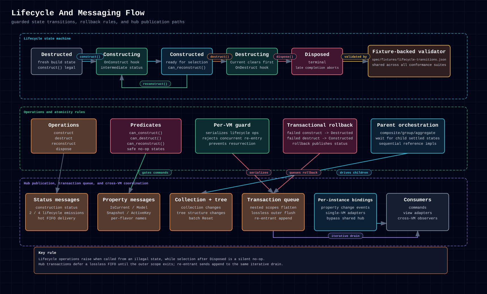

# 5.4. Lifecycle & Messaging

Lifecycle and messaging are the runtime spine of VMx. Construction transitions,
property messages, and collection events are coordinated so parent and child
trees behave predictably across flavors.

  <a href="../../assets/diagrams/lifecycle-messaging.html">Open standalone diagram</a>
  &middot;
  <a href="../../assets/diagrams/lifecycle-messaging.png">PNG</a>

This view is most useful when you need to reason about construct/destruct
ordering, hub notifications, or how state changes propagate across a VM tree.

## 5.4.1. Callback-Safe Transition Ordering

Lifecycle state admission and lifecycle callback delivery are deliberately
separate. Each VM atomically validates a transition, writes `Status`, and
reserves its place in a per-VM FIFO. Hub subscribers, local property observers,
command triggers, and lifecycle waiters then run after the private state guard
has been released. This preserves terminal `Disposed` ordering without letting
two VMs deadlock when concurrent observers call lifecycle operations on one
another. An ordinary foreign lifecycle call still waits for its publication;
only a wait that would close an actual cross-VM cycle may defer to the target's
running drainer. See ADR-0117 and specification chapter 02 §2.4.

The same principle applies to MessageHub delivery: callbacks run from an
ordered drain, not while a hub's state lock is held. Subscriber code should
still avoid unbounded publish cycles; development diagnostics identify those
cycles without truncating finite production delivery.

Concurrent hubs keep synchronous delivery, also from a callback, unless waiting
would close an actual cross-hub wait cycle (ADR-0119). In C# and Swift, that
cycle can also run through a container membership wait. See
[Hub Transactions](../primitives/services-messages-dispatching.md#667-hub-transactions)
for the full rule.

Swift notification replay also avoids lock cycles. The hub registers a pending
subscriber atomically, then attaches it outside the hub lock before
`CurrentValueSubject` replays the pending list.
