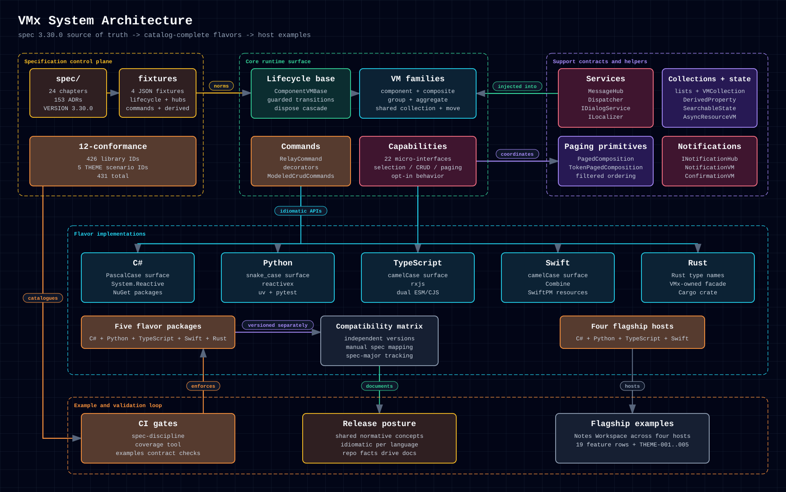

# 5.2. System Architecture

The system map shows how spec, lifecycle, services, messaging, flavors, and
host-application code fit together. It is the fastest way to see what VMx owns
and what stays in your app.

  <a href="../../assets/diagrams/system-architecture.html">Open standalone diagram</a>
  &middot;
  <a href="../../assets/diagrams/system-architecture.png">PNG</a>

The important boundary is that UI frameworks stay outside the VMx core. The
framework provides lifecycle, hierarchy, commands, services, and helpers; your
host app supplies models, view bindings, and platform-specific rendering.

## 5.2.1. Layers

The diagram has five bands. This page uses concept names; the
[Cross-Language Naming](../flavors/cross-language-naming.md) page gives each
flavor's spelling.

| Band                          | Part                  | Role                                                                                                                                                                      |
| ----------------------------- | --------------------- | ------------------------------------------------------------------------------------------------------------------------------------------------------------------------- |
| Specification control plane   | `spec/`               | Source of truth: 24 chapters, the ADRs, four JSON fixtures, and the catalog of 444 library IDs plus 5 THEME scenario IDs. `spec/VERSION` pins the version.                |
| Core runtime surface          | Lifecycle base        | A fixture-backed state machine guards every transition and runs the dispose cascade.                                                                                      |
| Core runtime surface          | VM families           | Component, composite, group, and fixed aggregate VMs, with shared child collections and atomic move.                                                                      |
| Core runtime surface          | Commands              | Relay commands with an execute action, a can-execute predicate, reactive triggers, and explicit re-evaluation; command decorators; modeled CRUD commands.                 |
| Core runtime surface          | Capabilities          | Opt-in micro-interfaces for selection, CRUD, paging, and related behavior.                                                                                                |
| Core runtime surface          | Services              | The message hub, the paired foreground/background dispatcher, the dialog service, and the localizer.                                                                      |
| Support contracts and helpers | Collections and state | Observable lists, VM collections, derived properties, searchable state, and async resource VMs.                                                                           |
| Support contracts and helpers | Paging primitives     | Paged and token-paged compositions with filtered ordering.                                                                                                                |
| Support contracts and helpers | Notifications         | The opt-in notification hub, notification VMs, and confirmation VMs.                                                                                                      |
| Flavor implementations        | Five packages         | C#, Python, TypeScript, Swift, and Rust implement the same concepts with idiomatic APIs. Each versions independently; the compatibility matrix maps versions to the spec. |
| Example and validation loop   | CI gates              | CI enforces spec discipline, conformance coverage, and example contracts.                                                                                                 |
| Example and validation loop   | Release posture       | All flavors share the normative concepts, keep idiomatic APIs, and derive their documentation from repository facts.                                                      |
| Example and validation loop   | Flagship examples     | The Notes Workspace runs on four hosts.                                                                                                                                   |

The diagram does not draw every part of the core. Specialized VMs (form,
discriminator, and modal), hierarchical and forwarding-wrapper VMs, messages,
tree utilities, and builders are also part of VMx.
