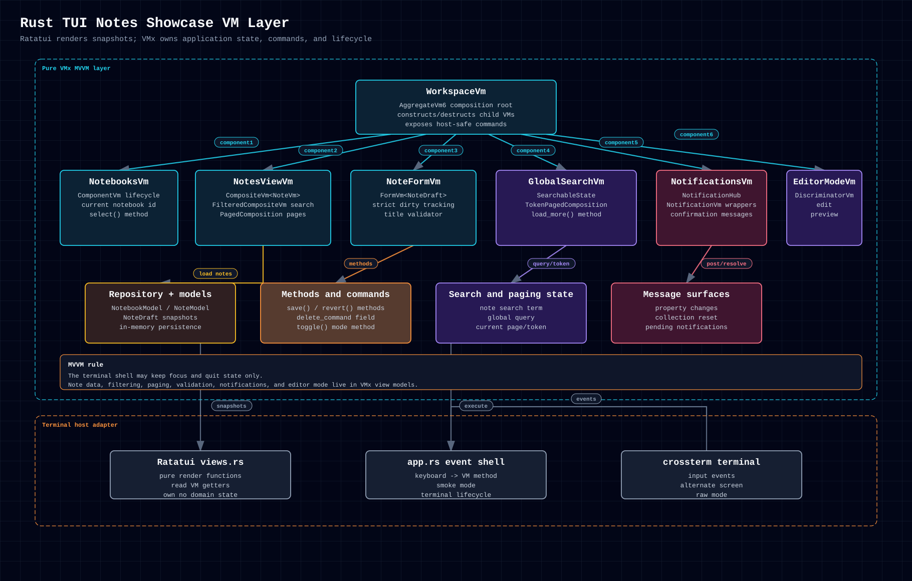

# 8.5. Rust TUI Notes Showcase

The Rust TUI Notes Showcase is the Rust-specific full MVVM example. Ratatui and
crossterm provide rendering and terminal input only; VMx owns the application
state, lifecycle, filtering, paging, commands, notifications, and editor mode.



<p>
  <a href="../../assets/diagrams/rust-tui-notes-showcase.html">HTML</a>
  &middot;
  <a href="../../assets/diagrams/rust-tui-notes-showcase.svg">SVG</a>
  &middot;
  <a href="../../assets/diagrams/rust-tui-notes-showcase.png">PNG</a>
</p>

## 8.5.1. What It Shows

- `WorkspaceVm` composes six child surfaces through `AggregateVm6`.
- `NotesViewVm` uses `CompositeVm`, `FilteredCompositeVm`, and
  `PagedComposition`. Each row is a `NoteVm`. A reload disposes the rows that
  it replaces, and the live rows are constructed with the workspace.
- A filter (`/`, `x`) or a page change (`n`, `p`) keeps the selected note and
  its editor draft (ADR-0201 §2.1), even when the change hides the note's row.
  The `j` and `k` keys select the next or the previous note on the visible
  page. The key map below lists the edge cases.
- `NoteFormVm` uses strict `FormVm<NoteDraft>` validation with `save()` and
  `revert()` methods. No key reaches them or edits the title, body, or tags,
  so the terminal editor always shows the stored note.
- `GlobalSearchVm` keeps its term in a `SearchableState` and pages repository
  search results with `TokenPagedComposition`. Load More continues the term of
  the loaded pages, as in the four flagships.
- `NotificationsVm` uses `NotificationHub` and `NotificationVm` wrappers. It
  disposes each entry it removes and, on disposal, every remaining entry, as
  in the four flagships. `visible()` lists only pending entries: it removes
  and disposes an entry that its dismiss command, its lifespan or the hub
  resolved. After disposal, `post()` adds no entry.
- `EditorModeVm` uses `DiscriminatorVm` for edit/preview switching. Only `m`
  switches it.

### 8.5.1.1. Key Map

`handle_key` in `examples/rust/tui/notes-showcase/src/app.rs` binds the 11 keys
below. Any other key does nothing.

| Key | Effect                                                                                  | View-model call                         |
| --- | --------------------------------------------------------------------------------------- | --------------------------------------- |
| `q` | Quits the app. The workspace is disposed on exit.                                       | none (the loop ends)                    |
| `/` | Filters the notes list by the fixed term `vmx`. It does not search all notes.           | `WorkspaceVm::set_search_term("vmx")`   |
| `x` | Clears the notes-list filter.                                                           | `WorkspaceVm::set_search_term("")`      |
| `n` | Shows the next page of the filtered list. Two notes make a page.                        | `WorkspaceVm::next_page`                |
| `p` | Shows the previous page.                                                                | `WorkspaceVm::previous_page`            |
| `j` | Selects the next note on the visible page.                                              | `WorkspaceVm::select_next_note`         |
| `k` | Selects the previous note on the visible page.                                          | `WorkspaceVm::select_previous_note`     |
| `m` | Toggles edit and preview mode. Only the header label changes.                           | `EditorModeVm::toggle`                  |
| `d` | Asks to delete the current note. The prompt stays until `y`, `r`, or a filter or page key (see the pending-delete rules below). | `WorkspaceVm::request_delete_current`   |
| `y` | Approves the pending delete, removes the note, posts a `Deleted` notice, and moves the selection onto the visible page when needed. | `WorkspaceVm::approve_delete_current`   |
| `r` | Rejects the pending delete.                                                             | `WorkspaceVm::reject_delete_current`    |

Selection and paging edge cases:

- `j` and `k` act on the visible page only. When the current note is hidden by
  a filter or a page, either key selects the first visible note. At the first
  or last visible row, the selection stays.
- `n` and `p` stop at the last and the first page.
- `m` changes only the header label (`mode: edit` or `mode: preview`). The
  editor draws the same in both modes.

### 8.5.1.2. Pending Delete

`d` targets the current note, even when a filter or a page hides its row. A
second `d` while a prompt is pending adds nothing.

The prompt names the targeted note, and `y` deletes that note even after `j` or
`k` selects another one. `/`, `x`, `n`, and `p` reject a pending prompt, so a
later `y` has nothing to approve. `j`, `k`, and `m` leave the prompt pending.

### 8.5.1.3. Features Without Keys

These view-model features have methods, but no key reaches them:

- **Notebook selection:** `WorkspaceVm::select_notebook`,
  `NotebooksVm::select`, and `NotesViewVm::set_notebook`. The first seeded
  notebook stays current.
- **Note selection by id:** `WorkspaceVm::select_note` and
  `NotesViewVm::select_note`. No key selects a note by id. `j` and `k` move the
  selection one row at a time.
- **Global search:** `GlobalSearchVm::set_query`, `query`, `refresh`, and
  `result_titles`. The screen does not draw its results. `/` filters the notes
  list, not the global search. Outside the tests, only the `--smoke` run calls
  `refresh`.
- **Load more:** `GlobalSearchVm::load_more` and `can_load_more`.
- **Title, body, and tag edits:** `NoteFormVm::set_title`, `set_body`, and
  `set_tags`.
- **Save and revert:** `NoteFormVm::save` and `NoteFormVm::revert`.
- **Explicit mode switch:** `EditorModeVm::show_edit` and
  `EditorModeVm::show_preview`. Only `m` toggles the mode.
- **Notification dismissal:** `NotificationEntry::dismiss_command`. The
  `Deleted` notice that `y` posts expires after 60 seconds and has no key.
- **Note creation:** the sample has no create-note feature.

The features that §8.5.2 omits have no key either.

## 8.5.2. Parity Scope

This is a **reduced companion**, not a fifth canonical Notes Workspace
flagship. It proves Rust-native MVVM composition, but it intentionally omits
the THEME scenario IDs, `IDialogService` export, the capability action bar, the async
dispatcher scenario, and tag autocomplete. Consequently,
`tools/check-showcase-parity.py` checks the shared test-file names,
THEME scenario markers, and the two shared scenarios across C#, Python,
TypeScript, and Swift only.

## 8.5.3. Run It

=== "Smoke"

    ```bash
    cargo run --locked --manifest-path examples/rust/tui/notes-showcase/Cargo.toml -- --smoke
    ```

=== "Tests"

    ```bash
    cargo test --locked --manifest-path examples/rust/tui/notes-showcase/Cargo.toml
    ```

=== "Interactive"

    ```bash
    cargo run --locked --manifest-path examples/rust/tui/notes-showcase/Cargo.toml
    ```

## 8.5.4. MVVM Boundary

The TUI shell may keep focus and quit state. It must not keep note data, search
terms, selected note state, form draft state, page tokens, notifications, or
editor mode. Those concerns live in the VMx view models and are covered by the
example crate's VM-layer tests.
