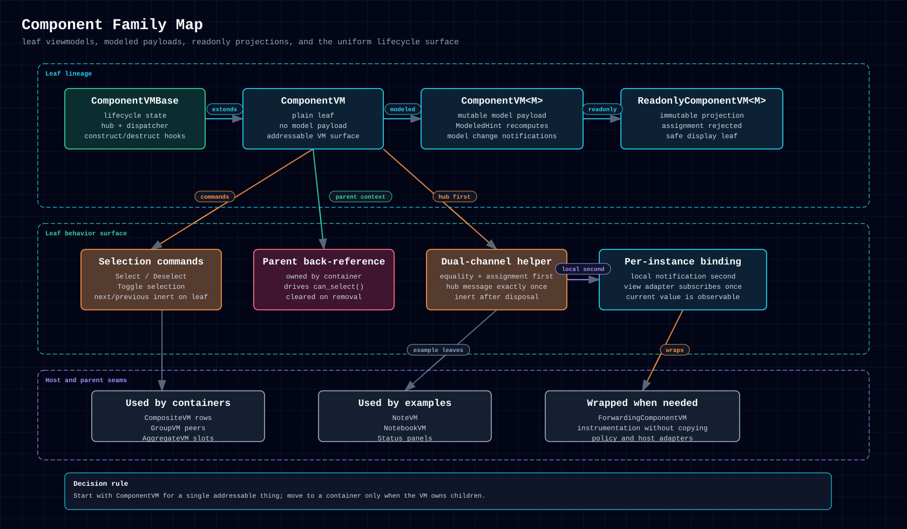

# 6.2.2. Component Family

## 6.2.2.1. When To Use It

Use `ComponentVM` for any addressable leaf VM that is not itself a container.
This is the default choice for note rows, notebook rows, status panels,
capability bars, and other single-node surfaces.

Reach for the modeled variant when the VM owns a domain payload, and the
readonly variant when the payload should be fixed after construction.



<p>
  <a href="../../../assets/diagrams/component-family.html">HTML</a>
  &middot;
  <a href="../../../assets/diagrams/component-family.svg">SVG</a>
  &middot;
  <a href="../../../assets/diagrams/component-family.png">PNG</a>
</p>

## 6.2.2.2. Shape And Ownership

The component family has three shipped variants:

| Variant                                               | Owns model | Model mutable | Typical use                  |
| ----------------------------------------------------- | ---------- | ------------- | ---------------------------- |
| `ComponentVM`                                         | No         | n/a           | simple leaf state            |
| `ComponentVM<M>` / `ComponentVMOf<M>`                 | Yes        | Yes           | editable or refreshable leaf |
| `ReadonlyComponentVM<M>` / `ReadonlyComponentVMOf<M>` | Yes        | No            | immutable projection         |

All variants share the same lifecycle base, built-in selection commands, and
per-instance property-changed surface. They also carry the internal `Parent`
back-reference used by selection predicates, but they never own children.

The injected hub is publicly readable on every component (`Hub` in C# and
`hub` elsewhere) but remains application-owned shared infrastructure. Disposing
a VM never disposes that hub.

## 6.2.2.3. Lifecycle And Messaging

Construction is leaf-local: there is no child orchestration. The family still
publishes the same status transitions and property-changed messages as every
other VM.

Important behavior from the spec:

- `Model` changes publish only on real value change.
- `ModeledHint` recomputes only when the model actually changes.
- A model assignment that begins after disposal is inert before equality,
  retained-state mutation, hint recomputation, callbacks, or either
  notification channel. The previous model and hint remain readable.
  Forwarding components and Swift's internal read-only update path inherit
  this guard.
- `SelectNextCommand` and `SelectPreviousCommand` exist for uniform surface,
  but the base leaf implementation is inert.
- `can_select()` depends on `Parent`, current-selection state, and the leaf
  being constructed.

## 6.2.2.4. Cross-Language Surface

| Concept           | C#                       | Python                     | TypeScript                 | Swift                      | Rust                     |
| ----------------- | ------------------------ | -------------------------- | -------------------------- | -------------------------- | ------------------------ |
| Unmodeled leaf    | `ComponentVM`            | `ComponentVM`              | `ComponentVM`              | `ComponentVM`              | `ComponentVm`            |
| Modeled leaf      | `ComponentVM<M>`         | `ComponentVMOf[M]`         | `ComponentVMOf<M>`         | `ComponentVMOf<M>`         | `ComponentVm<M>`         |
| Readonly leaf     | `ReadonlyComponentVM<M>` | `ReadonlyComponentVMOf[M]` | `ReadonlyComponentVMOf<M>` | `ReadonlyComponentVMOf<M>` | `ReadonlyComponentVm<M>` |
| Builder entry     | `Builder()`              | `builder()`                | `builder()`                | `builder()`                | `builder()`              |
| Property channel  | `INotifyPropertyChanged` | `property_changed`         | `propertyChanged`          | `propertyChanged`          | `property_changed()`     |
| Shared hub        | `Hub`                    | `hub`                      | `hub`                      | `hub`                      | `hub()`                  |
| Own until dispose | `Own(...)`               | `_own(...)`                | `own(...)`                 | `own(...)`                 | `own(...)`               |
| Republish model   | `RepublishModel()`       | `republish_model()`        | `republishModel()`         | `republishModel()`         | `republish_model()`      |

## 6.2.2.5. Explicitly Republishing The Retained Model

Use explicit republish when observable state reachable through the retained
model changed without a model replacement, and adapters refresh from the model
property notification. One call sends one ordinary model notification on both
channels. It does not compare or assign the model, recompute the hint, or run
`OnModelChanged` / `onModelChanged`.

Writable and read-only modeled leaves expose republish, and
`ForwardingComponentVM` delegates it to the wrapped VM. `FormVM` does not
expose it.

```typescript
// heightFields is external renderer state reachable through this cell VM.
heightFields.set(cell.coordKey, heightField);
cell.republishModel();
```

Do not use republish to hide a model replacement or a mutation that belongs in
the equality-gated setter. Assign through that setter instead. See spec/05 §3.3 for
the full contract, including disposal, null hubs, and re-entrant calls.

## 6.2.2.6. Owning Long-Lived Resources

Subclass authors can register subscriptions, commands, child view-models, and
cleanup callbacks that should live until terminal VM disposal. Swift and Rust
register a closure, for example `own { child.dispose() }` (spec 02 §2.3). The
registry drains once in LIFO order after the subclass disposal hook; one
cleanup failure is isolated, and registration after disposal cleans
immediately. Reconstruct does not drain the registry.

The view-model below owns a child resource view-model and a built command, and
subscribes to a tick stream for each construct:

<!-- checked-snippet: langs/typescript/tests/unit/componentAuthoringRecipes.test.ts#component-authoring -->

```typescript
class MetricVM extends ComponentVMBase {
  readonly #api: MetricApi;
  readonly resource: AsyncResourceVM<Metric[]>;
  readonly refreshCommand: RelayCommand;
  #tickSubscription: Subscription | null = null;

  constructor(api: MetricApi, hub: IMessageHub, dispatcher: IDispatcher) {
    super({ name: "metric", hub, dispatcher });
    this.#api = api;
    // The loader runs after construction, so it can read #private state.
    this.resource = this.own(
      new AsyncResourceVM({
        name: "metric-data",
        hub,
        dispatcher,
        loader: (signal) => this.#api.fetch(signal),
      }),
    );
    // Owned: disposing MetricVM disposes the command, which is then inert.
    this.refreshCommand = this.own(
      RelayCommand.builder()
        .task(() => void this.resource.load())
        .build(),
    );
  }

  get type(): ViewModelType {
    return ViewModelType.Component;
  }

  // A per-construct subscription starts on construct and ends on destruct.
  protected override _onConstruct(): void {
    super._onConstruct();
    this.#tickSubscription = this.#api.ticks.subscribe(() => {
      void this.resource.load();
    });
  }

  protected override _onDestruct(): void {
    this.#tickSubscription?.unsubscribe();
    this.#tickSubscription = null;
    super._onDestruct();
  }
}
```

- **Own built commands.** A command that is not owned stays executable after
  its view-model is disposed, and it keeps its trigger subscriptions until it is
  disposed itself. In Python, TypeScript, and Swift, a trigger on the owner's
  `propertyChanged` ends at disposal, because that stream completes; the C#
  `PropertyChanged` event does not. A disposed command is inert (ADR-0068).
- **Owned child view-models are disposed parent-first.** The parent publishes
  `Disposed`, runs its disposal hook, and then disposes its owned resources in
  reverse registration order. Containers do the opposite: they dispose their
  children before themselves (`LIFE-013`).
- **Per-construct resources** start in `OnConstruct` and end in `OnDestruct`
  (or their flavor equivalents; ADR-0041 §2, §4). A resource registered with `own`
  survives reconstruct. The helper deliberately does not expose two mutable
  lifetime bags.

## 6.2.2.7. Children Of A Leaf View-Model

A leaf that constructs child view-models in its own construct hook does not get
container semantics. The hook does not wait for a background child (spec 02
§6). If a synchronous child fails, the parent rolls back but earlier children
stay constructed; if a background child fails, the parent stays `Constructed`.
Use a container instead:

- `GroupVM` or `CompositeVM` for children of one type.
- `AggregateVM1` to `AggregateVM6` for up to six typed children. Built with
  factories, they run the factories on every construct, and reconstruct
  replaces the slots (spec 08 §2, §4).

The order in which a container constructs or destructs its children is
unspecified (spec 02 §6, ADR-0047 §2.5).

## 6.2.2.8. Callbacks And Construction Order

- VMx calls some callbacks only from `construct()` or `load()`: an
  `AsyncResourceVM` loader, the children-models factory and mapper of a modeled
  composite, and a `currentSelector`. Unless the subclass constructor itself
  calls `construct()` or `load()`, they may capture `this` or `self`, including
  private fields.
- In Python and TypeScript, a `modeledHinter` runs inside the base constructor,
  before a subclass initializes its own fields. In every flavor, it should read
  only the model it receives.
- `currentSelector` receives the composite in C#, Python, and TypeScript, an
  array of children in Swift, and a `Vec` of children in Rust.

## 6.2.2.9. Authoring A Mutable Property

A component property has two audiences: cross-VM coordination through the
message hub and host binding through the VM's local property-change surface.
The subclass helper keeps those channels paired and ordered.

| Flavor     | Subclass helper            |
| ---------- | -------------------------- |
| C#         | `NotifyPropertyChanged`    |
| Python     | `_notify_property_changed` |
| TypeScript | `_notifyPropertyChanged`   |
| Swift      | `_notifyPropertyChanged`   |
| Rust       | `notify_property_changed`  |

The caller first determines that a change was accepted. A setter still owns its
equality check and assignment; a computed refresh runs only after its
underlying state changes. One helper call invokes exactly one hub
`PropertyChangedMessage` send, then exactly one local notification carrying the
current value. A call begun after disposal is inert, while a call admitted
before disposal completes both channels even if a hub observer disposes the VM.
Property names follow the flavor idiom (`ActiveTab`, `active_tab`, or
`activeTab`). The lower-level local-only raise primitive stays available for
framework lifecycle properties that deliberately do not publish to the hub.

Ordinary top-level delivery is observed hub first. Inside a hub transaction or
re-entrant drain, the hub queues its delivery, so a local observer may run
before the queued hub observer even though the helper invoked the hub first.

```typescript
set activeTab(value: string) {
  if (this._activeTab === value) return;
  this._activeTab = value;
  this._notifyPropertyChanged("activeTab");
}
```

Do not wrap fields with a VMx property decorator or descriptor. Explicit
setters preserve each flavor's idioms and make equality, assignment, and
notification order visible at the mutation site.

The C#, Python, TypeScript, and Swift Notes Showcase viewmodels use this
helper.

## 6.2.2.10. Example

Representative modeled leaf shape across the five source flavors:

- `C#`: `ComponentVM<TabModel>.Builder().Name("home-tab").Model(model).Services(hub, dispatcher).Build()`
- `Python`: `ComponentVMOf[TabModel].builder().name("home-tab").model(model).services(hub, dispatcher).build()`
- `TypeScript`: `ComponentVMOf.builder<TabModel>().name("home-tab").model(model).services(hub, dispatcher).build()`
- `Swift`: `try ComponentVMOf<TabModel>.builder().name("home-tab").model(model).services(hub: hub, dispatcher: dispatcher).build()`
- `Rust`: `ComponentVm::with_model("home-tab", model, hub, dispatcher)`

The [Quickstart](../../getting-started/index.md) uses this pattern before
composing those leaves into a `CompositeVM`.

## 6.2.2.11. Common Pitfalls

- Using a component when the VM really owns a collection. Move up to
  `CompositeVM`, `GroupVM`, or `AggregateVM`.
- Expecting the built-in next/previous commands on a leaf to walk siblings.
  Container-driven navigation is the intended model.
- Subclassing the sealed concrete leaf (C# `ComponentVM` / `ComponentVM<M>`).
  Derive from the component base instead.
- Forgetting that a detached leaf has no `Parent`, so selection predicates stay
  false until a container owns it.
- Disposing `vm.hub` from the VM. Public visibility does not transfer ownership.
- Registering per-construct work with `own`; it would survive reconstruct.
- Redeclaring a member that the base class owns: `status`, `isConstructed`,
  `isCurrent`, `name`, `hint`, `hub`, or `propertyChanged` (in the flavor's
  spelling). Containers read `child.status`. Swift rejects a redeclared
  `status`, a TypeScript `status` field does not compile, and C# only hides the
  non-virtual `Status`. A TypeScript `get status()` or Python `status` property
  override compiles silently, and a container that constructs the child then
  fails. In Python, assigning `self.status` raises `AttributeError`. Name a
  derived status differently, for example `panelStatus`, or expose it as
  `AsyncResourceVM` does with `state.status`.
- Treating the post-disposal model guard as task cancellation. Cancel upstream
  work to release resources; rely on the guard only to reject a late result.

## 6.2.2.12. Related Primitives

- [Composite Family](composite-family.md)
- [Group Family](group-family.md)
- [Aggregate Family](aggregate-family.md)
- [FormVM](specialized/form-vm.md)
- [State & Reactive Helpers](../state-reactive-helpers.md)
