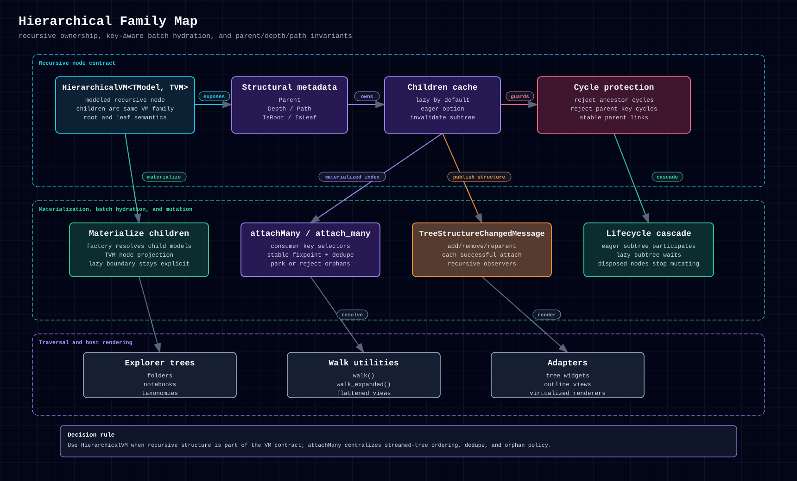

# 6.2.6. Hierarchical Family

## 6.2.6.1. When To Use It

Use `HierarchicalVM<TModel, TVM>` when the domain is intrinsically recursive:
folders, notebooks, comment threads, taxonomies, or any tree whose nodes need
parent, depth, and path semantics.

This family exists so you do not have to manually recurse a `CompositeVM` and
rebuild tree bookkeeping in every app.



<p>
  <a href="../../../assets/diagrams/hierarchical-family.html">HTML</a>
  &middot;
  <a href="../../../assets/diagrams/hierarchical-family.svg">SVG</a>
  &middot;
  <a href="../../../assets/diagrams/hierarchical-family.png">PNG</a>
</p>

## 6.2.6.2. Shape And Ownership

A hierarchical node owns its `Model` and its structural metadata: `Parent`,
`Depth`, `Path`, `IsRoot`, and `IsLeaf`. It does not own the lifetimes of its
`Children`. Destructing or disposing a node does not destruct, dispose, detach,
or reparent its children; only eager construction cascades (spec 18 §3). The
consumer owns child lifetimes: dispose a subtree explicitly (§6.2.6.4), or
register cleanup through the owned-resource helper.

Children are lazy by default. Eager mode applies per node. An eager node
constructs its children depth-first. The whole tree is eager only when every
node is eager.

The structural root also owns a small pending set for `attachMany` batch
hydration. Pending nodes are not part of `Children` until their selected parent
is materialized.

## 6.2.6.3. Lifecycle And Messaging

The important differences from manual recursive composites are:

- lazy children do not participate until materialized
- structural mutations publish `TreeStructureChangedMessage`
- cache invalidation publishes property-changed for the children property

The family integrates directly with the tree walkers `walk` and
`walk_expanded` (flavor-idiomatic spellings). See
[Builders, Collections & Tree Utilities](../builders-collections-tree-utilities.md).

Every node needs the application hub and dispatcher. A node built without them
publishes its tree and property messages to a private hub that no binding
observes. `HierarchicalVMBuilder` requires both. A subclass passes its services
to the children that its factory creates:

<!-- checked-snippet: langs/typescript/tests/unit/hierarchicalServicesRecipe.test.ts#hierarchical-services -->

```typescript
interface NavItem {
  title: string;
  children: NavItem[];
}

class NavNodeVM extends HierarchicalVM<NavItem, NavNodeVM> {
  constructor(model: NavItem, hub: IMessageHub, dispatcher: IDispatcher) {
    super({
      model,
      hub,
      dispatcher,
      // Each child gets the same services, so its messages reach `hub`.
      childrenFactory: (parent) =>
        parent.model.children.map((item) => new NavNodeVM(item, hub, dispatcher)),
    });
  }
}
```

C#, Python, and Swift require the services. The TypeScript raw constructor still
accepts a node without them, but that form is `@deprecated`, and TypeScript 4.0
requires both. Rust's `HierarchicalVm::new` builds a private hub; use
`with_children_factory` to pass the application hub (ADR-0009).

## 6.2.6.4. Disposing A Subtree

To dispose a node with its materialized descendants, walk the subtree
depth-first. The recipe below disposes children before their parent, keeps
going after a failed node, and rethrows the first failure, as spec 02 §7
requires of a container. It is TypeScript; the same walk applies in every
flavor.

<!-- checked-snippet: langs/typescript/tests/unit/hierarchicalSubtreeDisposalRecipe.test.ts#dispose-subtree -->

```typescript
interface DisposableTreeNode {
  readonly children: readonly DisposableTreeNode[];
  dispose(): void;
}

/** Disposes a node's materialized subtree, children first. */
function disposeSubtree(node: DisposableTreeNode): void {
  let failed = false;
  let firstError: unknown;
  const attempt = (action: () => void): void => {
    try {
      action();
    } catch (error) {
      if (!failed) {
        failed = true;
        firstError = error;
      }
    }
  };
  for (const child of [...node.children]) attempt(() => disposeSubtree(child));
  attempt(() => node.dispose());
  if (failed) throw firstError;
}
```

Reading `children` materializes a lazy level, so the recipe builds and
constructs children that were never shown before it disposes them. It reaches
only the current children. A node that was reparented into another tree, or
dropped by `invalidateChildren`, is no longer in the subtree, and its new owner
disposes it.

## 6.2.6.5. Progressive Batch Hydration

Use `attachMany` / `AttachMany` / `attach_many` when windows can overlap or
arrive out of order. The consumer supplies the domain key and parent-key
selectors; VMx owns fixpoint ordering, deduplication, orphan policy, and the
existing parent/path/message invariants.

```ts
const result = canvasRoot.attachMany(windowNodes, {
  keyOf: (node) => node.model.id,
  parentKeyOf: (node) => node.model.parentId, // null means canvasRoot
  onMissingParent: MissingParentPolicy.Park,
});

for (const rejection of result.rejections) {
  diagnostics.record(rejection.item, rejection.reason);
}
```

The root indexes only itself and already-materialized descendants, so batch
attachment never expands a lazy subtree just to search for a parent. It scans
the active nodes to a fixpoint: a parent added later in the input unlocks its
earlier children on the next pass, while sibling order remains the original
input order.

The result separates `added`, `duplicates`, `orphans`, and typed `rejections`.
Same-key nodes never replace an existing VM. `park` retains only genuine
missing-parent items for the next call; `reject` returns them without retaining
them. Cycles, already-attached nodes, and selector/attachment failures are
terminal structured results rather than batch-stopping exceptions. Disposing
the root clears its parked set.

Consumers still adapt domain facts that the generic tree must not own, such as
forest roots, alias parent IDs, and creation of registered domain nodes.

## 6.2.6.6. Cross-Language Surface

| Concept            | C#                                   | Python                               | TypeScript                           | Swift                                   | Rust                              |
| ------------------ | ------------------------------------ | ------------------------------------ | ------------------------------------ | --------------------------------------- | --------------------------------- |
| Core type          | `HierarchicalVM<TModel, TVM>`        | `HierarchicalVM[TModel, TVM]`        | `HierarchicalVM<TModel, TVM>`        | `HierarchicalVM<TModel, TVM>`           | `HierarchicalVm<M>`               |
| Builder            | `HierarchicalVMBuilder<TModel, TVM>` | `HierarchicalVMBuilder[TModel, TVM]` | `HierarchicalVMBuilder<TModel, TVM>` | `HierarchicalVM<TModel, TVM>.builder()` | `HierarchicalVm::builder()`       |
| Eager flag         | `EagerChildren(true)`                | `eager_children(True)`               | `eagerChildren(true)`                | `eagerChildren(true)`                   | `eager_children(true)`            |
| Invalidate subtree | `InvalidateSubtree()`                | `invalidate_subtree()`               | `invalidateSubtree()`                | `invalidateSubtree()`                   | `invalidate_subtree()`            |
| Batch attach       | `AttachMany(...)`                    | `attach_many(...)`                   | `attachMany(...)`                    | `attachMany(...)`                       | `attach_many(...)`                |
| Root parent key    | `BatchParentKey<TKey>.Root`          | `None`                               | `null`                               | `nil`                                   | `None`                            |
| Parked count       | `ParkedAttachCount`                  | `parked_attach_count`                | `parkedAttachCount`                  | `parkedAttachCount`                     | `parked_attach_count()`           |

## 6.2.6.7. Example

The current Notes Workspace examples do **not** subclass `HierarchicalVM` in
any flavor. In the C#, Python, TypeScript, and Swift showcases, each
`NotebooksRootVM` owns a flat notebook collection plus
`roots` / `childrenOf` / `walk` projections and republishes
`TreeStructureChangedMessage`, which gives the host tree-shaped state without
making the VM itself a recursive node tree. The Rust TUI companion keeps a
plain `NotebooksVm` list instead.

Use `HierarchicalVM` when the VM graph should actually be recursive:

These concise examples show the canonical builder path per flavor. C#, Swift,
and TypeScript use `TestNode`, a minimal `HierarchicalVM` subclass that each
snippet assumes, as their concrete recursive node;
Python can build plain `HierarchicalVM` directly and uses `vm_factory(...)` only
when a subclass is required.

=== "C#"

    ```csharp
    var root = HierarchicalVMBuilder<string, TestNode>.Empty
        .Model("root")
        .ChildrenFactory(_ => Array.Empty<TestNode>())
        .Services(hub, dispatcher)
        .VmFactory(ctx => new TestNode(
            ctx.Model, ctx.ChildrenFactory, ctx.Hub, ctx.Dispatcher,
            ctx.Name, ctx.Hint, ctx.EagerChildren))
        .Build();
    ```

=== "Python"

    ```python
    root = (
        HierarchicalVMBuilder[str, HierarchicalVM[str, Any]]()
        .model("root")
        .children_factory(lambda _parent: [])
        .services(hub, dispatcher)
        .build()
    )
    ```

=== "TypeScript"

    ```ts
    const root = new HierarchicalVMBuilder<string, TestNode>()
      .model("root")
      .childrenFactory((_parent) => [])
      .services(hub, dispatcher)
      .vmFactory((ctx) => new TestNode(ctx))
      .build();
    ```

=== "Swift"

    ```swift
    let root = try HierarchicalVM<String, TestNode>.builder()
        .model("root")
        .childrenFactory { _ in [] }
        .services(hub: hub, dispatcher: dispatcher)
        .vmFactory { model, childrenFactory, hub, dispatcher, name, hint, eager in
            TestNode(
                model: model,
                childrenFactory: childrenFactory,
                hub: hub,
                dispatcher: dispatcher,
                name: name,
                hint: hint,
                eagerChildren: eager
            )
        }
        .build()
    ```

That split is the practical rule: use the tree primitive when the tree is real,
not simply because the UI displays indentation.

## 6.2.6.8. Common Pitfalls

- Recursing `CompositeVM` instead of using the tree primitive and then having to
  rebuild `Parent`, `Depth`, and `Path` yourself.
- Expecting lazy children to exist during construct without materializing them.
- Expecting `dispose()` on a node to dispose its children. Dispose the subtree
  explicitly (§6.2.6.4).
- Treating cache invalidation as structural mutation. It is a refresh contract,
  not an add/remove event.
- Reparenting a node under itself or its descendants. The contract rejects these
  cycles.
- Using a mutable or call-dependent batch key selector. Parked nodes are retried
  with the next call's selectors, so key semantics must stay stable.
- Treating `park` as a general retry queue. Only missing-parent items park;
  duplicates, cycles, and invalid links are terminal results.

## 6.2.6.9. Related Primitives

- [Composite Family](composite-family.md)
- [State & Reactive Helpers](../state-reactive-helpers.md)
- [Builders, Collections & Tree Utilities](../builders-collections-tree-utilities.md)
