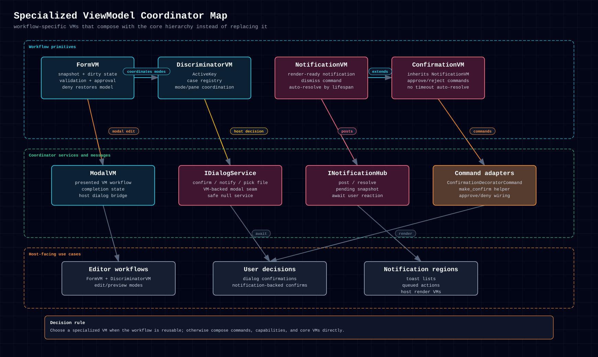

# 6.2.8.1. Specialized ViewModels & Coordinators

The specialized primitives are not alternate container shapes. Each one solves
a workflow problem that occurs in many apps, and it wraps or coordinates other
VM state. It does not replace the core ownership families. If the need is only
"a leaf with one more property", use a plain `ComponentVM` with a command or a
property instead.

  <a href="../../../../assets/diagrams/specialized-vm-family.html">HTML</a>
  &middot;
  <a href="../../../../assets/diagrams/specialized-vm-family.svg">SVG</a>
  &middot;
  <a href="../../../../assets/diagrams/specialized-vm-family.png">PNG</a>

## 6.2.8.1.1. Choose A Page

- [FormVM](form-vm.md): edit a snapshot of a model, validate it, and approve or
  revert it.
- [DiscriminatorVM](discriminator-vm.md): switch the active case, such as an
  edit or preview mode, and keep the selection observable.
- [NotificationVM](notification-vm.md) and
  [ConfirmationVM](confirmation-vm.md): hold render-ready notification state
  from the notification hub.
- [ModalVM](modal-vm.md): complete a presented modal workflow with a result.

The Notes Workspace editor composes `FormVM` and `DiscriminatorVM`, and its
notifications pane projects pending notifications into `NotificationVM`
instances. Each page links its example files.

## 6.2.8.1.2. Related Primitives

- [ViewModel Families](../index.md)
- [Command Families](../../command-families.md)
- [Services, Messages & Dispatching](../../services-messages-dispatching.md)
