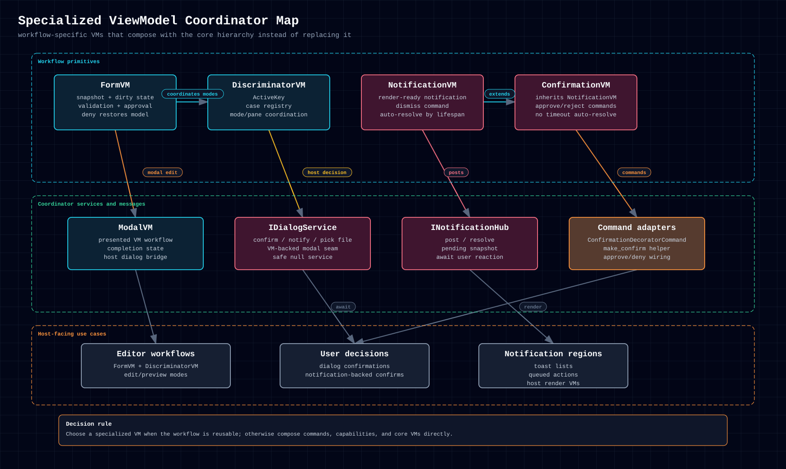

# 6.2.8.1. Specialized ViewModels & Coordinators

## 6.2.8.1.1. When To Use It

These primitives are not alternate container shapes. They solve specific
workflow problems that show up repeatedly across apps:

- `FormVM` for snapshot/revert/approve edit flows
- `DiscriminatorVM` for active-mode or active-pane coordination
- `NotificationVM` and `ConfirmationVM` for render-side notification state
- `ModalVM` for VM-backed modal completion

Use them when the workflow itself is the reusable primitive. If the need is
just "a leaf with one more property", stay on the core hierarchy and compose the
smaller helpers instead.

  <a href="../../../../assets/diagrams/specialized-vm-family.html">HTML</a>
  &middot;
  <a href="../../../../assets/diagrams/specialized-vm-family.svg">SVG</a>
  &middot;
  <a href="../../../../assets/diagrams/specialized-vm-family.png">PNG</a>

## 6.2.8.1.2. Shape And Ownership

These types typically wrap or coordinate other VM state rather than replacing
the core ownership hierarchy:

- `FormVM` owns edit snapshots and approval/revert flow around a target VM
- `DiscriminatorVM` owns active-case switching
- `NotificationVM` and `ConfirmationVM` own render-ready notification state
- `ModalVM` owns completion state around a presented modal workflow

## 6.2.8.1.3. Lifecycle And Messaging

Specialized primitives matter when a recurring workflow has its own lifecycle
or message flow:

- forms track dirty/valid/approve/revert transitions
- discriminators switch active cases while keeping case selection observable
- notification and confirmation VMs mirror host notification streams
- modal VMs bridge VM state with dialog completion

## 6.2.8.1.4. Cross-Language Surface

All five source flavors ship the same conceptual set of specialized primitives,
with idiomatic naming differences only.

## 6.2.8.1.5. Example

The Notes Workspace flagships use specialized primitives instead of ad
hoc state on unrelated container VMs:

- the editor pane composes `FormVM` and `DiscriminatorVM`
- the notifications pane projects `INotificationHub.Pending` into
  `NotificationVM` instances
- the dialog adapters show where `ModalVM` fits when `IDialogService.Present`
  is the right host seam

The dedicated pages cover each workflow's hooks, host seams, and flavor-specific
helper APIs, and link the relevant example files.

## 6.2.8.1.6. Common Pitfalls

- Reaching for a specialized primitive when a plain `ComponentVM` plus a command
  or property would do.
- Treating these pages as alternatives to the core container families.
- Assuming every example app must use every specialized primitive directly.

## 6.2.8.1.7. Related Primitives

- [ViewModel Families](../index.md)
- [Command Families](../../command-families.md)
- [Services, Messages & Dispatching](../../services-messages-dispatching.md)
