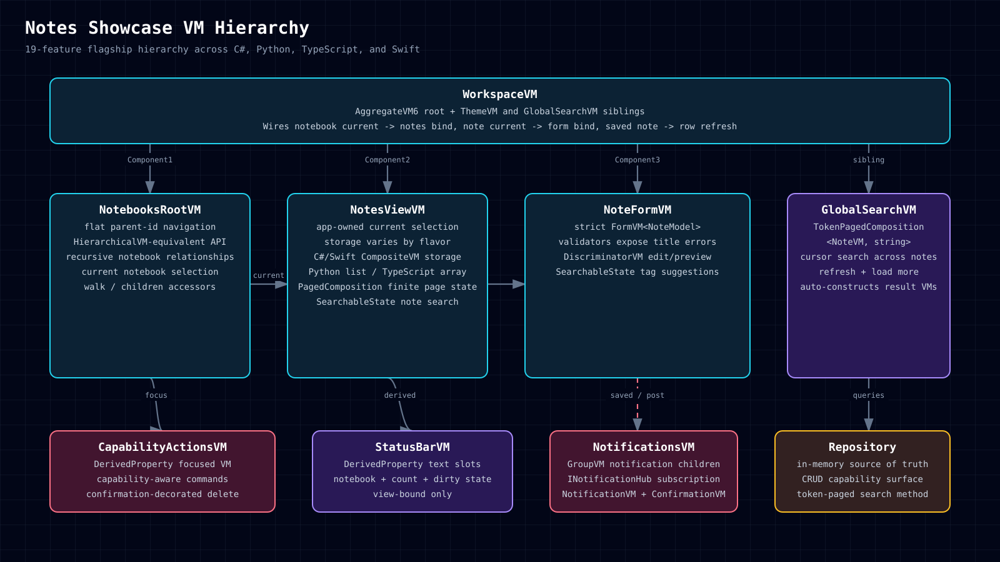

# Notes Workspace — cross-flavor parity matrix

The Notes Workspace is the VMx flagship UI example portfolio: one scenario
(`spec/proposals/2026-05-29-notes-showcase-scenario.md`), implemented by the
UI-backed flavors through one language-neutral VM API. This matrix records
where every in-scope spec feature is exercised in each UI-backed flavor. Two
separate checks back it:

- **Structural:** `tools/check-showcase-parity.py` requires every flavor to ship
  the same per-VM test files and the `THEME-00x` scenario markers. It
  checks names and markers only, not what the tests assert.
- **Behavioral:** two shared scenarios run in every flagship, and each
  flavor's suite compares every step's semantic snapshot with the same
  expectation. A mismatch fails that suite with the scenario, flavor, step, and
  differing value.
  - [`notes-showcase-scenario.json`](notes-showcase-scenario.json)
    (`notes-lifecycle-v1`) runs one bounded workspace lifecycle: construct,
    create, select, edit, an invalid title, save, a declined delete, a theme
    change, a rejected theme, and teardown. Its snapshot covers notes order,
    selection, form state, theme, domain events, error kind, and disposal.
  - [`notes-showcase-theme-scenario.json`](notes-showcase-theme-scenario.json)
    (`theme-v1`) runs `THEME-001`..`THEME-005` in order against one theme VM.
    The steps are a preset change, a rejected preset, and a high-contrast
    round trip that keeps the accent. Then the font scale clamps at both
    bounds, a repeated value publishes nothing, and the VM follows the host
    theme. Its snapshot covers the theme fields, every `ThemeChangedMessage`
    with both halves, error kind, and disposal.

  Each file lists the only normalized differences, all idiomatic per ADR-0006
  or preset palette values; event order is never normalized. The reduced Rust
  companion runs neither. Its scope omits the theme VM. It also has no modal
  delete dialog; it uses an inline delete confirmation instead.

Published walkthroughs:
[Notes Workspace](../docs/content/examples/notes-workspace.md),
[VM layer map](../docs/content/examples/notes-workspace-vm-layer.md).

## 1. VM hierarchy

The VM tree is derived from the scenario contract and applies identically to
all four flagship implementations. Names use their language-neutral form per
ADR-0006.

The diagram source is at
[`assets/notes-showcase-vm-hierarchy.svg`](assets/notes-showcase-vm-hierarchy.svg);
a browsable HTML version with summary cards is at
[`assets/notes-showcase-vm-hierarchy.html`](assets/notes-showcase-vm-hierarchy.html),
and a high-resolution PNG export is at
[`assets/notes-showcase-vm-hierarchy.png`](assets/notes-showcase-vm-hierarchy.png).

The companion VMx component map shows which framework primitive each example
VM composes: [`assets/notes-showcase-vmx-components.svg`](assets/notes-showcase-vmx-components.svg),
[`assets/notes-showcase-vmx-components.html`](assets/notes-showcase-vmx-components.html),
and [`assets/notes-showcase-vmx-components.png`](assets/notes-showcase-vmx-components.png).

## 2. Flavors

- **C# / Avalonia 12 on .NET 8** — `examples/csharp/avalonia/NotesShowcase/`
- **Python / Textual ≥ 0.80** — `examples/python/textual/notes_showcase/`
- **TypeScript / React 19 + Vite** — `examples/typescript/react/notes-showcase/`
- **Swift / SwiftUI + Combine (macOS)** — `examples/swift/notes-showcase/` (ADR-0067)

The Rust Ratatui Notes Showcase is a **reduced companion**, not a fifth
flagship column. It demonstrates a pure Rust MVVM terminal composition. It
does not claim the canonical 19-feature scenario. It omits `THEME-001..005`,
`IDialogService` export, the capability action bar, the async dispatcher
scenario, and tag autocomplete. The
[Rust TUI guide](../docs/content/examples/rust-tui-notes-showcase.md#852-parity-scope)
describes its scope, and the [Rust example README](rust/README.md) has its run
commands.

### 2.1. Feature matrix

Each column reports whether the flavor implements the VM or spec surface and
wires it into the flagship host. `Yes` means that the flavor's VM or model
tests and its host integration cover the feature. §3 lists the checks that
keep the view layer free of state.

| #   | Spec feature (chapter / capability)                   | C# / Avalonia | Python / Textual | TypeScript / React | Swift / SwiftUI |
| --- | ----------------------------------------------------- | ------------- | ---------------- | ------------------ | --------------- |
| 1   | `HierarchicalVM` (ch. 18) — notebooks tree[^hier]     | Yes           | Yes              | Yes                | Yes             |
| 2   | App-owned `current` selection (models `CompositeVM.Current`, ch. 6) — notes selection[^current] | Yes | Yes              | Yes                | Yes             |
| 3   | `ComponentVM<M>` modeled (ch. 5) — `NoteVM`/`NotebookVM` | Yes        | Yes              | Yes                | Yes             |
| 4   | `FormVM` snapshot/revert/validation (ch. 20) — note editor with title errors | Yes | Yes | Yes | Yes |
| 5   | `DerivedProperty` (ch. 15) — status bar, capability actions | Yes     | Yes              | Yes                | Yes             |
| 6   | `RelayCommand` + `AsyncRelayCommand` reactive `canExecute` (ch. 4) — persistence-backed actions[^commands] | Yes | Yes | Yes | Yes |
| 7   | `SearchableState` + `IFilterable<TItem>` (ch. 14 §2.5–2.6) — note search + starred filter[^search] | Yes | Yes | Yes | Yes |
| 8   | `IPageable` + `PagedComposition` (ch. 14 §2.10, ch. 21) — notes pagination | Yes | Yes           | Yes                | Yes             |
| 9   | `INotificationHub` + `NotificationVM` (ch. 16) — toast region | Yes   | Yes              | Yes                | Yes             |
| 10  | Async `construct()` + dispatcher (ch. 2, 11) — workspace load + notebook switch + save[^dispatcher] | Yes | Yes | Yes | Yes |
| 11  | `TreeStructureChangedMessage` (ch. 18) — add notebook re-publishes tree | Yes | Yes           | Yes                | Yes             |
| 12  | `ConfirmationDecoratorCommand` (ch. 4) — delete confirm | Yes         | Yes              | Yes                | Yes             |
| 13  | `IDialogService` (ch. 19) — export → save-file dialog, then a notification once the file is written | Yes | Yes | Yes | Yes |
| 14  | Capability-aware UI (ch. 14 §4) — capability action bar[^readonly] | Yes   | Yes              | Yes                | Yes             |
| 15  | `AggregateVM6` (ch. 8) — `WorkspaceVM` composes 6 children | Yes | Yes         | Yes                | Yes             |
| 16  | `ThemeVM` scenario contract (proposal 2026-06-02) — theme state as a VM, and the theme control strip of §2.3[^theme] | Yes | Yes | Yes | Yes |
| 17  | `TokenPagedComposition` (ch. 21) — global all-notes search with forward tokens | Yes | Yes | Yes | Yes |
| 18  | `DiscriminatorVM` (ch. 22) — edit/preview note editor mode | Yes | Yes | Yes | Yes |
| 19  | `SearchableState<string>` — workspace tag autocomplete in `NoteFormVM` | Yes | Yes | Yes | Yes |

Row 17 has an explicit item-lifetime boundary. Each `GlobalSearchVM` owns every
constructed `NoteVM` that it creates until its terminal disposal. This includes
results that a refresh replaces and results that equality or stale-operation
handling discards. The Rust TUI counterpart stores cloned `NoteModel` values
with their search term. Thus it owns no lifecycle-bearing search results.

[^commands]: The persistence-backed workspace, notebook, form, capability,
    Save, and Delete actions are awaitable. Repository failures stay
    observable. A success notification appears only after the data persists.

[^search]: The notes list and the global search share one search rule. The
    rule trims the term, and an empty term matches every note. Otherwise, a note
    matches when its title, its body, or one of its tags contains the term. The
    match ignores case.

[^theme]: The `ThemeVM` holds the palette, the accent, the font scale, and the
    high-contrast state. Each flavor ships it with its view-models and ships a
    per-framework `ThemeAdapter` in `views/adapter/` (Swift:
    `Sources/NotesShowcase/Adapter/`). `WorkspaceVM` owns the `ThemeVM` as a
    sibling of its six aggregate children. The host binds the adapter to that
    workspace-owned instance.

    Composition as a seventh aggregate child is **deferred** until the core
    library adds an `AggregateVM7`. See
    `spec/proposals/2026-06-02-theme-vm-scenario.md` §8 and ADR-0036 §2.C / §4
    decision #3.

    The flagship test trees under `examples/<lang>/.../tests/` test the
    `THEME-001..005` scenario IDs. The library suites under
    `langs/<flavor>/tests/conformance/` do not. The `_SCENARIO_PREFIXES` set in
    `tools/check-conformance-coverage.py` exempts these IDs from the
    library-coverage gate.

[^readonly]: The core capability action bar ships in all four UI-backed
    examples. It dispatches CRUD capabilities, and `DerivedProperty` values
    drive its enablement. Each `CapabilityActionsVM` also exposes the host-gated
    add-note command, which the notebook read-only flag controls. Seed data and
    VM tests show that the command is disabled when the focused notebook is
    read-only.

[^current]: All four flagships drive selection through an app-owned `current`
    slot, not through `CompositeVM.Current`. They store their notes list in
    different ways. C# and Swift keep the notes in a `CompositeVM<NoteVM>` that
    they use only as storage. Python keeps them in an `ObservableList`, and
    TypeScript keeps them in a plain array.

    Each flagship exposes its own `current`/`Current` property and a selection
    command. The observable selection contract is the same in all flavors: one
    current note, a change notification, and a clear on delete. The per-VM test
    suites cover this contract. The library conformance corpus tests the
    `CompositeVM.Current` primitive directly (COMP-006/010/025).

[^dispatcher]: Only C# and Swift wire the async-`construct()` marshalling half
    of this row to a live UI dispatcher. C# uses `AvaloniaDispatcher` on
    Avalonia's global UI thread, and Swift uses `DefaultDispatcher`.

    The React and Textual flagships ship a purpose-built adapter:
    `ReactDispatcher` (asap microtask) and `TextualDispatcher` (asyncio). The
    `views/adapter/` unit tests exercise these adapters. But the composition
    roots build the VM tree on the synchronous immediate dispatcher. Thus
    `constructAsync()` completes before the first paint, and no
    render-before-construct flicker occurs. To marshal foreground work onto the
    framework loop, wire the shipped adapter.

### 2.2. Locale scope

The shared scenario is intentionally an en-US reference host. Labels, seed
content, validation messages, and notifications are English literals in all
four flagships and the reduced Rust companion. This matrix does not claim a
localization row. VMx's injectable `ILocalizer`/`Localizer` contract remains a
consumer integration point that the five library conformance suites cover.
Translated application catalogs are outside this example scenario.

### 2.3. Interaction and theme policies

ADR-0201 sets these policies for every app that has the feature. The reduced
Rust companion has no theme VM and no capability action bar, so only the
first two policies apply to it.

1. **Selection after a refilter or a page change.** A search, the starred
   filter or a page change never changes `current`. While the current note is
   not on the visible page, the editor keeps that note and its draft. When
   the note is visible again, the list marks it as selected again. While
   the note is hidden, no list row is selected.

   The Rust TUI selects notes with `j` and `k` on the visible page. Its `d`
   key deletes the current note even while its row is hidden, and the prompt
   names that note.
1. **Unsaved edits on a note switch.** A selection of another note discards
   the unsaved draft with no prompt. The editor then shows the stored values
   of the selected note. The dirty marker and the enabled Save and Revert
   show an unsaved draft before the switch.
1. **The action-bar Save.** The action-bar Save on the note that the editor
   holds is the editor Save. It persists the draft with the same validation
   and the same "Saved" notification. It persists nothing when the draft is
   clean or not valid. For any other focused note, it persists the stored
   model.
1. **Theme controls.** All four flagships ship one theme control strip. It
   has a button for each preset (`setThemeCommand`) and a high-contrast toggle
   (`toggleHighContrast`). It also has decrease and increase font-size
   buttons, which call `setFontScale` with the current factor minus or plus
   0.1. No flagship ships an accent or follow-system control.
1. **Accent validation.** `setAccentColor` accepts only `#RGB` or `#RRGGBB`.
   It rejects any other value like an unknown preset in `THEME-002`: no
   `ThemeChangedMessage` and no model change. Swift rejects through
   `applyAccentColor(_:)`, and its command discards the rejection. A C#
   `null` accent sent through the command does nothing, because
   `RelayCommand<string>` does not run its task for `null`.
1. **Follow-system with no provider.** No flagship passes a host theme
   provider. With no provider, `followSystemCommand` keeps the theme values
   and sets `followsSystem` to true.

Each app tests each policy that applies to it in its VM tests. The C#,
Python and TypeScript view tests also run each theme control.

## 3. Reading the matrix

- **Parity is enforced.** All four flagships ship per-VM unit tests that
  mirror the VM API: `tests/viewmodels/` (C#: `NotesShowcase.Tests/ViewModels/`,
  Swift: `Tests/NotesShowcaseTests/`). The C#, Python, and TypeScript
  flagships also ship a headless view smoke test that boots the app and
  asserts that the main view rendered.

  Swift has no smoke test of the full app. Its `HostLifecycleTests` hosts a
  SwiftUI view through the binding bridge in a real AppKit window. The test
  checks appearance, disappearance, and main-thread delivery of a change made
  on a worker thread.
- **View code is declarative.** These checks keep view code free of state, so
  no `Yes` entry depends on incidental view-side state:
  - `tools/check-axaml-codebehind.py` limits each C# view code-behind under
    `Views/` to the XAML loader call.
  - `tools/check-textual-views.py` limits the methods of the Python Textual
    view widgets.
  - The `no-restricted-imports` rule in the React
    [`eslint.config.js`](typescript/react/notes-showcase/eslint.config.js)
    forbids `useState` and `useReducer` in `src/views/components/`.
  - `tools/check-layer-imports.py` checks the Model, ViewModel, and View
    import directions in the C#, Python, and TypeScript flagships.
  - In Swift, SwiftPM target boundaries keep the `NotesShowcaseCore` VM layer
    apart from the `NotesShowcase` SwiftUI target.
- **`AggregateVM6` (row 15)** is the spec extension this portfolio drove
  (ADR-0034). It lets `WorkspaceVM` compose its six heterogeneous children
  without a synthetic chrome wrapper.
- **Swift / SwiftUI binding bridge.** The Swift flagship uses a Combine→SwiftUI
  bridge: `BindableVM`, `BindableCollection`, `BindableCommand`,
  `BindableDerived`, and `ThemeAdapter`. The bridge is not part of the library
  (ADR-0036 "no new core types"). It is contained in the `NotesShowcase` app
  target. Views use `@StateObject`/`@ObservedObject` and live VM getters. The
  [Swift README](swift/notes-showcase/README.md) gives the build
  requirements and the foreground-execution rules.

[^hier]: The TypeScript React example builds its notebooks tree from
    `HierarchicalVM<NotebookModel, NotebookVM>` nodes under a hidden root. A
    `TreeSelection` (spec 18 §10, ADR-0164) holds its `current` notebook. The
    C#, Python, and Swift examples do not subclass `HierarchicalVM<TModel, TVM>`
    directly. They use an equivalent pattern: a flat collection with parent-id
    navigation.

    All four examples keep the same observable contract. Each one sends a
    `TreeStructureChangedMessage` with the added kind when a notebook is added
    or the tree is populated. No flagship removes notebooks. Each one also
    keeps a `current` selection and provides `walk()` and `childrenOf()`
    accessors. Thus capability dispatch and spec-level tree messages behave as
    they do with a canonical `HierarchicalVM`.

    Per-flavor sources:
    `examples/csharp/avalonia/NotesShowcase/ViewModels/NotebooksRootVM.cs`,
    `examples/python/textual/notes_showcase/src/notes_showcase/viewmodels/notebooks_root_vm.py`,
    `examples/typescript/react/notes-showcase/src/viewmodels/notebooksRootVM.ts`,
    and
    `examples/swift/notes-showcase/Sources/NotesShowcaseCore/ViewModels/NotebooksRootVM.swift`.

## 4. Cross-references

- Scenario contract: [`spec/proposals/2026-05-29-notes-showcase-scenario.md`](../spec/proposals/2026-05-29-notes-showcase-scenario.md)
- ADR-0034: [`spec/ADRs/0034-aggregate-vm6.md`](../spec/ADRs/0034-aggregate-vm6.md)
- ADR-0067: [`spec/ADRs/0067-swift-notes-showcase-flagship.md`](../spec/ADRs/0067-swift-notes-showcase-flagship.md) — Swift flagship decision record
- Reduced Rust companion: [`examples/rust/README.md`](rust/README.md#21-parity-role)
- Per-flavor READMEs:
  [`examples/csharp/avalonia/NotesShowcase/README.md`](csharp/avalonia/NotesShowcase/README.md),
  [`examples/python/textual/notes_showcase/README.md`](python/textual/notes_showcase/README.md),
  [`examples/typescript/react/notes-showcase/README.md`](typescript/react/notes-showcase/README.md),
  [`examples/swift/notes-showcase/README.md`](swift/notes-showcase/README.md)
