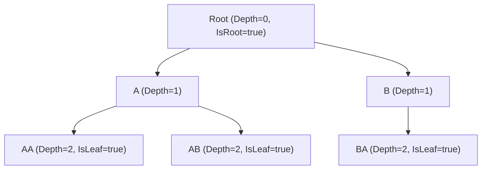
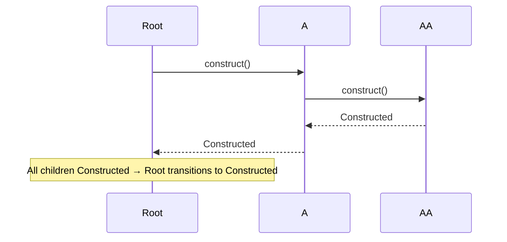

# 18 — `HierarchicalVM<TModel, TVM>`

A **first-class recursive tree-structured ViewModel**. Each node may contain
children of the same VM type. Use for domains that are natively recursive: file
directories, comment threads, org charts, nested taxonomies, decision trees.

See [ADR-0028](ADRs/0028-hierarchical-vm.md) for the design rationale and the
six resolved design questions.

## 1. Overview

`HierarchicalVM<TModel, TVM>` is a recursive specialization of the VM hierarchy.
Each instance carries a `Model` (the domain payload), a lazy or eager list of
`Children` of the same concrete VM type, and structural metadata (`Parent`,
`Depth`, `Path`, `IsRoot`, `IsLeaf`, `IsFirst`, `IsLast`).

Unlike manually recursing `CompositeVM<M, VM>` (chapter 06), `HierarchicalVM`
provides:

- built-in parent / depth / path bookkeeping,
- depth-first construction order without implied child-lifetime ownership,
- hub messages for structural mutations,
- clean integration with `walk`/`walk_expanded` (chapter 13) and opt-in
  capability composition (chapter 14).

## 2. Shape

`HierarchicalVM<TModel, TVM>` is a recursive generic type. `TVM` is the concrete
subclass; the recursive constraint is enforced per flavor (ADR-0028 §3 item 2).
Swift's compiler rejects the self-referential bound, so Swift binds only
`TVM: AnyObject`.

Open Rust gap: Rust `HierarchicalVm<M>` has no `TVM` parameter. Children and
parent are the same `HierarchicalVm<M>` type, so a consumer cannot specialize
the node type.

```
HierarchicalVM<TModel, TVM>:
    Model    : TModel                  # per-node domain model
    Parent   : TVM?                    # null when IsRoot
    Children : IReadOnlyList<TVM>      # lazy by default; eager via constructor option
    Depth    : int                     # 0 for root; Parent.Depth + 1 otherwise
    Path     : IReadOnlyList<TVM>      # materialized snapshot: root, …, self
    IsRoot   : bool                    # Parent is null
    IsLeaf   : bool                    # Children.Count == 0
    IsFirst  : bool                    # Parent.Children[0] == self (false when IsRoot)
    IsLast   : bool                    # Parent.Children[^1] == self (false when IsRoot)

    InvalidateChildren() -> void       # drop this node's materialized child cache
    InvalidateSubtree() -> void        # drop this node + materialized descendants
    AttachMany(items, selectors, policy) -> BatchAttachResult<TVM>
    ParkedAttachCount : int            # pending missing-parent nodes on root
```

`Model` is the per-node domain model; the recursive-children factory function is
supplied by the consumer at construction time.

Example tree (three levels):



## 3. Construction order

**Depth-first.** A parent's `Status` transitions to `Constructed` only after
every child that its construction constructs has reached `Constructed`; this
preserves the invariant "children exist before parent reports ready". This
construction coordination does not imply ownership: disposing a hierarchical
node does not dispose, destruct, detach, reparent, or otherwise manage its
children. Destructing a node does not destruct its children either; only eager
construction cascades. Consumers own child lifetimes unless they register
cleanup explicitly through the ordinary owned-resource surface.

Lazy children do NOT participate in construction order until materialized. A node
with un-materialized children is `Constructed` once it has called `construct()`
itself. First access to `Children` builds the lazy children and sets their
parents. It does not construct them.

Sequence for a two-level eager tree:



## 4. Lazy vs eager children

Default: **lazy.** `Children` is materialized on first access by invoking the
children factory delegate.

Factory hydration is a snapshot/preflight/commit transaction (ADR-0127). The
complete result is materialized before mutation and MUST contain only distinct,
detached object identities. A null-like entry, duplicate identity, this node or
one of its ancestors, or any node with a non-null parent rejects the complete
snapshot. Rejection installs no cache, changes no parent/path state, publishes
no message, and a later access retries the factory. A valid snapshot is cached
in factory order and its parent backpointers are assigned silently. Factory
hydration never transfers a node; use `AddChild` for explicit transfer.
If the factory re-enters a structural operation on its receiver, including
add, remove, reparent, batch attach, or cache invalidation, the complete
hydration attempt is rejected with the same no-mutation/no-message guarantee.
The cache remains empty and a later access retries the factory.

Swift exposes fallible `tryChildren()` and Rust exposes `try_children()` for
this validation result. Their existing `children` accessors delegate and fail
fast on invalid factory output for source compatibility. C#, Python, and
TypeScript use their ordinary invalid-operation errors.

Constructor option `eagerChildren=true` (C# / TS) / `eager_children=True`
(Python) / `eagerChildren: true` (Swift) / builder method
`eager_children(true)` (Rust) flips a node to **eager**: its `construct()`
materializes and constructs its children, depth first. The option applies to
each node separately, so the entire tree is materialized at construct time when
every node is eager; a children factory usually passes the option on to the
nodes it creates. Eager mode is required if the consumer wants depth-first
construction to apply to the whole tree at startup.

## 5. Child-cache invalidation

Lazy `Children` are cached after first materialization. Consumers that need to
refresh a node's children explicitly call:

- `InvalidateChildren` / `invalidate_children` / `invalidateChildren` — drops
  this node's materialized child cache. The next `Children` access invokes the
  children factory again. Calling it before materialization is a no-op.
- `InvalidateSubtree` / `invalidate_subtree` / `invalidateSubtree` — applies the
  same invalidation recursively to this node and all currently materialized
  descendants.

Invalidation is a cache refresh operation, not a structural remove. It does not
publish `TreeStructureChangedMessage`; instead it publishes
`PropertyChangedMessage("Children")` (or the flavor-idiomatic property name) for
the node whose cache was dropped so subscribers can re-read. The dropped
children are detached silently: their parent becomes null, and no per-child
`Parent` message is published. The §7 `Parent` message rule applies to
structural mutations, not to invalidation.

Time-to-live refresh is intentionally deferred. A TTL contract needs a
cross-flavor clock/test-scheduler abstraction to be deterministic; explicit
invalidation is the v3.1 cache contract.

## 6. Key-aware batch attachment

`AttachMany` / `attach_many` / `attachMany` ingests out-of-order node windows
without turning ordinary hydration anomalies into exceptions. Each call
requires:

- `keyOf(node)` — a stable, non-null, hashable identity key;
- `parentKeyOf(node)` — the desired parent key, or the root sentinel;
- `onMissingParent` — `park` (default) or `reject`.

Python, TypeScript, Swift, and Rust use `None` / `null` for the root sentinel.
C# uses `BatchParentKey<TKey>.Root`, rather than null, so value-type and
reference-type keys have the same type-safe surface.

The receiver first resolves its structural root. A root-sentinel item becomes a
direct child of that root even when the method was invoked on a descendant.
The operation indexes the root and all **already-materialized** descendants; it
MUST NOT invoke a lazy children factory merely to build the index.

The first materialized node or active candidate for a key is authoritative.
Later same-key items are returned in `duplicates` with
`DuplicateExistingKey` / `DuplicateBatchKey`; they never replace or reparent the
authoritative node. An item already attached outside the indexed tree is
rejected as `AlreadyAttached` and its original links remain unchanged.

Candidates are scanned repeatedly in input order. A candidate attaches when
its parent is in the materialized/added index; each successful node immediately
joins that index. Scanning stops at a fixpoint. This resolves arbitrary
child-before-parent chains and preserves relative input order among siblings.
Previously parked items precede new input in the active scan.

The structured result contains:

```
BatchAttachResult<TVM>:
    Added       : IReadOnlyList<TVM>
    Duplicates  : IReadOnlyList<TVM>
    Orphans     : IReadOnlyList<TVM>
    Rejections  : IReadOnlyList<BatchAttachRejection<TVM>>

BatchAttachRejection<TVM>:
    Item    : TVM
    Reason  : DuplicateExistingKey | DuplicateBatchKey | AlreadyAttached |
              MissingParent | Cycle | SelectorFailed | AttachmentFailed
    Detail  : string?  # diagnostic only; never required for branching
```

Every non-added active item has one rejection entry. `Orphans` contains only
items whose parent key is absent at the fixpoint. Parent-key cycles are reported
as `Cycle`, are not orphans, and are never retained.

With `park`, new missing-parent items are retained in a structural-root-owned
pending list and retried before the next batch. With `reject`, they are returned
but not retained. Already-parked items remain parked until resolved, terminally
rejected, or the root is disposed. `ParkedAttachCount` exposes the pending count;
root disposal clears it.

Duplicates, missing parents, cycles, already-attached items, selector failures,
and underlying attachment failures MUST NOT abort the batch. Successful nodes
use the existing `AddChild` path, preserving parent/path/message invariants. If
that path fails unexpectedly after beginning mutation, VMx rolls the child-list
and parent link back before returning `AttachmentFailed`.

## 7. Hub messages

Two messages flow on `IMessageHub`:

- **`PropertyChangedMessage`** — emitted on `Parent` change, child-cache
  invalidation, and any other `IReadable<T>` properties on the node, per chapter
  03 rules.
- **`TreeStructureChangedMessage`** (defined in §8) — emitted on structural
  mutations: add, remove, or reparent of descendants.

Structural mutators MUST reject operations that would corrupt the tree:
reparenting a node under itself or under one of its own descendants (an
ancestor cycle) raises the flavor's standard invalid-operation error
(`InvalidOperationException` / `ValueError` / `Error`; Swift reports
`HierarchyError.invalidReparent`, thrown by `reparentChild` and returned as
`.failure` by `addChild`, and Rust returns `Err(VmxError::InvalidArgument)`),
leaves the tree
unchanged, and publishes no message (HIER-018; added in v2.5.0 via
ADR-0037 — previously the cycle silently corrupted `Depth`/`Path`/`walk`).

`AddChild` is an attach-or-transfer operation, not a raw list append. It MUST
preflight the same cycle rule before mutation. Adding an existing child of the
same parent is a no-op. Adding a child owned by another parent atomically
removes the identity-equal entry from the old parent's children, appends it to
the new parent, updates the parent/path state, and publishes one `Reparented`
message from the new parent. Adding a detached child publishes `Added`. On any
rejection or attachment failure, both parent collections and the child's parent
reference remain unchanged. Swift reports `AddChild` rejection through its
idiomatic `Result`; Rust uses `VmxResult`; the other flavors throw their
standard invalid-operation error (ADR-0105).

## 8. `TreeStructureChangedMessage`

```
TreeStructureChangedMessage:
    Source   : HierarchicalVM          # the node whose subtree changed
    Change   : Added | Removed | Reparented
    Affected : HierarchicalVM          # the node added/removed/reparented
    Index    : int                     # index in Children list (-1 for Reparented if N/A)
```

## 9. Integration

- **`walk` / `walk_expanded`** (chapter 13): `HierarchicalVM` is a natural input.
  `walk` yields depth-first descendants including the root. Order is
  `parent → children[0] → children[0].children[0] → … → children[1] → …`.
- **`ExpandableState`** (chapter 05 §8, ADR-0015): consumers may compose the
  non-generic `ExpandableState` to expose `IExpandable`. `walk_expanded`
  (chapter 13 §5, §6) then skips the children of a collapsed node; Rust does
  not stop there yet (chapter 13 §6 open gap). Expansion does not materialize
  children: they materialize on first `Children` access, or at construct time
  with the eager option (§4). `HierarchicalVM` does NOT auto-implement
  `IExpandable` — per ADR-0028 §3.6 and ADR-0010, capabilities are opt-in.
- **`SearchableState`** (chapter 06 §8, ADR-0014): consumers may compose
  `SearchableState<TVM>` to provide a filtered view of a tree. The filter
  operates on the materialized portion.
- **`ModeledCrudCommands`** (chapter 06 §7, ADR-0016): tree mutations (Create /
  Update / Delete on a node's children) compose with the existing
  `CreateNewCommand`, `UpdateCurrentCommand`, `DeleteCurrentCommand` helpers.

## 10. Tree selection

A tree node cannot be the `Current` item of a container: its inherited
`Select()` delegates to the container back-reference (chapter 05 §6.1), which
tree nodes never set. A consumer that needs one current node per tree composes
the opt-in `TreeSelection` helper on a tree node, its **root** (ADR-0164). The
helper adds no `HierarchicalVM` member and implements no capability on the
nodes.

```
TreeSelection<TVM>:                     # constructed on a root node
    Current        : TVM?               # null when nothing is selected
    CanSelect(node) -> bool
    Select(node)   -> void              # rejects a node that CanSelect rejects
    Clear()        -> void
    CurrentChanged : Observable<TVM?>   # emits on every effective change
    Dispose()      -> void
```

| Flavor     | Type                         | Change stream                                                 | Rejection                      |
| ---------- | ---------------------------- | ------------------------------------------------------------- | ------------------------------ |
| C#         | `TreeSelection<TModel, TVM>` | `IObservable<TVM?> CurrentChanged`                            | `InvalidOperationException`    |
| Python     | `TreeSelection[TVM]`         | `current_changed: Observable[TVM \| None]`                    | `ValueError`                   |
| TypeScript | `TreeSelection<TVM>`         | `currentChanged: Observable<TVM \| null>`                     | `Error`                        |
| Swift      | `TreeSelection<TModel, TVM>` | `currentChanged: AnyPublisher<TVM?, Never>`                   | `TreeSelectionError.notInTree` |
| Rust       | `TreeSelection<M>`           | `current_changed() -> ValueStream<Option<HierarchicalVm<M>>>` | `VmxError::InvalidArgument`    |

Swift's `select(_:)` throws (ADR-0053), and Rust's `select` returns a
`VmxResult<()>`.

### 10.1 Members of the selectable tree

`CanSelect(node)` is true iff all of these hold:

1. the helper is not disposed;
1. walking `Parent` links from `node` reaches the root (the root itself
   qualifies); and
1. no node on that path, from `node` to the root, is `Disposed`.

A non-null `Parent` exists only while the node is in that parent's
materialized child list (§4, §5, §7). So the walk visits only the root's
materialized tree. `CanSelect` and `Select` never invoke a children factory
and never read `Children`.

`Select(node)` first checks `CanSelect(node)`. When the check fails, the call
raises the error in the table above, and `Current` keeps its value. This plays
the role of COMP-009 for trees, but only C#, Python and TypeScript raise the
same error as a `CompositeVM` does: Swift's `CompositeVM` throws
`CompositeMembershipError` and Rust's returns `VmxError::NonChild`. When the
check passes, `node` becomes current; selecting the current node again does
nothing. So a current node that left the tree before the helper cleared it is
rejected too. `Clear()` sets `Current` to null. `Select` and `Clear` do nothing
after `Dispose`.

### 10.2 Leaving the tree

`Current` becomes null when the current node leaves the root's selectable
tree:

- the node or one of its ancestors is removed (`RemoveChild`);
- the node or one of its ancestors is transferred to a parent outside the
  tree, including a parent in another tree on another hub;
- an ancestor's child cache is invalidated (§5), which leaves the dropped
  nodes live with a null parent; or
- the node or one of its ancestors is disposed. A disposed ancestor stays in
  the tree, because node disposal does not detach (§3).

A move inside the tree keeps the selection.

The helper detects these events by watching the path from the current node to
the root. Each event is published on its own hub by a node on that path: the
moved node publishes its `Parent` change (§7), the invalidated node publishes
its `Children` change (§5), and the disposed node publishes its status change
(chapter 02). On any message from a node on the path, the helper repeats the
§10.1 check. It clears the selection when the check fails, and it watches the
new path when the check passes. Spec §7 gains no message from the old parent.
The helper clears when it receives the message, so inside a hub transaction
(chapter 03 §7) the clear happens when the hub delivers it. A path node on a
hub that delivers nothing, such as a null or disposed hub, cannot be watched.

### 10.3 Change stream and ownership

`CurrentChanged` emits the new `Current`, or null, once for every effective
change. It does not replay a value to a new subscriber. A call or an event
that leaves `Current` unchanged emits nothing.

Every subscriber receives the changes in the order they happened, and the
last value it receives is the final `Current`. A subscriber may call `Select`
or `Clear` while it receives a value. The helper then finishes delivering that
value to every subscriber before it delivers the new one.

The helper publishes nothing to a message hub. The VM that owns it forwards
`CurrentChanged` to its own property-change notification (chapter 14 rule 6),
as with `ExpandableState` (chapter 05 §8).

The helper owns its hub subscriptions. `Dispose()` releases them, sets
`Current` to null without emitting, and completes the change stream. It runs
every step and rethrows the first failure; Rust resumes the first panic.
After disposal the helper is inert, and a second `Dispose()` does nothing.
Disposing the helper never disposes or detaches a node.

The helper follows the threading model of its tree. The Rust helper is
`Send + Sync`, like `HierarchicalVm<M>`. In the other flavors the helper, like
the tree, is used from one thread.

### 10.4 Selection does not navigate

`Select` and `Clear` change only the helper. They do not materialize, expand,
construct or move a node, do not change any node's `IsCurrent`, and publish no
hub message. A host maps `Current` to a route or a detail view.

## 11. Conformance

- `HIER-001` — Recursive generic constraint compiles per flavor with the bound
  type parameter.
- `HIER-002` — `Parent` is null for the root and a `TVM` reference for every
  non-root node.
- `HIER-003` — `Depth` derivation: root is 0; child is parent + 1.
- `HIER-004` — `Path` materialization: returns a read-only sequence
  `root, …, self`; identity-equal to a fresh recompute when nothing changed.
- `HIER-005` — `IsLeaf` and `IsRoot` derivation match `Parent`/`Children`
  state.
- `HIER-006` — `IsFirst` and `IsLast` position predicates.
- `HIER-007` — Default lazy child loading: `Children` is not materialized until
  first access.
- `HIER-008` — Eager child loading: `eagerChildren=true` (C# / TS) /
  `eager_children=True` (Python) / `eagerChildren: true` (Swift) constructor
  option, or the Rust builder method `eager_children(true)`, materializes and
  constructs this node's children at construct. Construction continues deeper
  only through children that are eager themselves.
- `HIER-009` — Depth-first construction: a parent reports `Constructed` only
  after every (eager) descendant.
- `HIER-010` — `PropertyChangedMessage` on `Parent` change.
- `HIER-011` — `TreeStructureChangedMessage` on add / remove / reparent.
- `HIER-012` — `walk_expanded` honors lazy boundaries when an `ExpandableState`
  gate is composed.
- `HIER-013` — Composition with `SearchableState` filters the materialized
  portion.
- `HIER-014` — Composition with `ModeledCrudCommands` mutates the tree.
- `HIER-015` — `HierarchicalVMBuilder<M, VM>.Build()` validates the required
  fields `Model`, `ChildrenFactory`, and `Services(hub, dispatcher)`. C#,
  TypeScript, and Swift also require the VM factory (`VmFactory` /
  `vmFactory`); Python's `vm_factory` is optional and defaults to
  `HierarchicalVM`, and Rust has no VM factory. A missing field raises
  `BuilderValidationException` (C#) / `BuilderValidationError` (Python,
  TypeScript, Swift) / `VmxError::BuilderValidation` (Rust) with a message
  identifying the missing field (added in v2.3 via ADR-0035).
- `HIER-016` — `HierarchicalVMBuilder<M, VM>` repeated identical `Build()`
  calls produce independent root nodes that share the same configured
  `Model`, `Hint`, and eager / lazy children policy.
- `HIER-017` — `HierarchicalVMBuilder<M, VM>` field defaults applied when
  not set: `Hint == ""`, `Name == typeof(TVM).Name` (or the flavor-idiomatic
  equivalent), and `EagerChildren == false` (so the root's children
  materialize lazily on first access).
- `HIER-018` — `ReparentChild` and `AddChild` reject self- and
  ancestor-reparenting without mutation or messages (Swift
  `HierarchyError.invalidReparent`, Rust `VmxError::InvalidArgument`); `AddChild` performs an
  atomic identity-based transfer when the child already has another parent
  (extended in v3.20.1 via ADR-0105).
- `HIER-019` — `InvalidateChildren` drops the cached child list; the next
  `Children` access invokes the factory again.
- `HIER-020` — `InvalidateChildren` on an unmaterialized node is a no-op and
  does not invoke the factory.
- `HIER-021` — `InvalidateSubtree` invalidates this node and all materialized
  descendants.
- `HIER-022` — Child-cache invalidation publishes a `PropertyChangedMessage`
  for the children property.
- `HIER-023` — Child-before-parent chains resolve to a fixpoint with stable
  sibling input order and ordinary structural invariants.
- `HIER-024` — Multiple root-sentinel items attach directly beneath the
  structural root in input order.
- `HIER-025` — Duplicate keys within a batch, against the materialized tree,
  and across repeated batches never throw or replace the authoritative node.
- `HIER-026` — `park` retains a missing-parent item and a later batch resolves
  it when the parent arrives.
- `HIER-027` — `reject` returns a missing-parent orphan without retaining it.
- `HIER-028` — Parent-key cycles are terminal typed rejections and are not
  parked as orphans.
- `HIER-029` — Every non-added item has a typed rejection; selector/attachment
  failures are contained and parent links remain atomic.
- `HIER-030` — Disposing the structural root clears its parked batch state.
- `HIER-031` — Factory hydration preflights the complete ordered snapshot and
  either attaches distinct detached nodes silently or rejects atomically with
  no cache, parent/path, or message mutation; rejection remains retryable.
- `HIER-032` — A factory that re-enters a structural operation on its receiver
  rejects the complete hydration attempt without mutation or messages; a later
  access retries normally.
- `HIER-033` — `TreeSelection` selects a member, ignores a repeated select or
  clear, and publishes each effective change once, in order, also when a
  subscriber selects again (§10, ADR-0164).
- `HIER-034` — `TreeSelection` rejects a detached node, a node of another tree
  and a disposed member without changing `Current` or invoking a factory.
- `HIER-035` — Removing the current node or an ancestor clears the selection.
- `HIER-036` — Transferring an ancestor out of the tree clears the selection,
  also across hubs; a move inside the tree keeps it.
- `HIER-037` — Invalidating an ancestor's child cache clears the selection.
- `HIER-038` — Disposing the current node or an ancestor clears the selection.
- `HIER-039` — Selection does not materialize, construct, move or mark a node
  and publishes no hub message.
- `HIER-040` — A disposed `TreeSelection` completes its stream, reads null and
  ignores later calls and tree changes.
