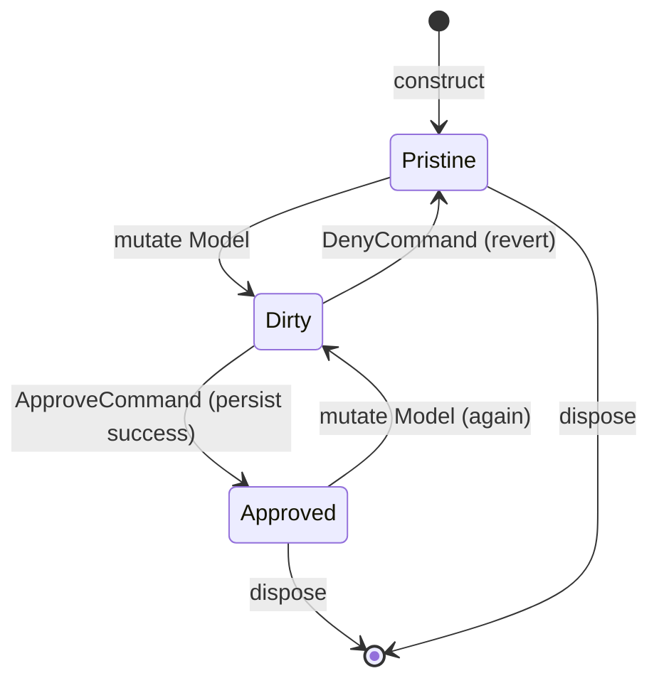

# 20 — `FormVM<TM>` (snapshot/revert edit lifecycle)

A **ViewModel that wraps a mutable domain model with an edit lifecycle**: snapshot on
construct, allow mutation, then either Approve (persist) or Deny (revert). See
[ADR-0030](ADRs/0030-form-vm.md) for the design rationale and the ORM-agnostic
decision.

## 1. Overview

`FormVM<TM>` is for any UI pattern that lets a user edit an entity and then either
save or cancel. It eliminates the recurring boilerplate of snapshot/dirty/revert that
appears in every CRUD screen.

Key properties:

- **ORM-agnostic** — the persist step is a consumer-supplied delegate or
  `IFormPersister<TM>` collaborator.
- **Snapshot at construct** — `Snapshot` is captured once and is immutable after
  that (until a successful `ApproveCommand` updates it). C#, Python,
  TypeScript, and Rust use deep-copy defaults (Rust uses the model's `Clone`);
  Swift uses identity copy for unconstrained generic models and relies on value
  semantics for struct/enum models (ADR-0077). The snapshot mechanism is
  injectable in every flavor (Rust: `FormVmBuilder::snapshotter`).
- **`IsDirty`** is derived automatically from structural inequality of `Model` vs
  `Snapshot`, using an **injectable equality function** (default: a structural
  deep-equal — §4).
- **`DenyCommand`** (Cancel) reverts `Model` to `Snapshot` and publishes hub
  messages.
- **`ApproveCommand`** (Save) invokes the persister; on success updates `Snapshot`
  and raises `OnApproved`. A persister failure on the fire-and-forget command path
  is surfaced on `ApproveErrors` (§8). One approval runs at a time; a second
  approve while one is in flight does nothing (§5.3).
- **Validation** (opt-in): field/model validators produce `Errors`; approval is
  disabled while invalid (§5).
- **Strict mode** (opt-in): `ApproveCommand.CanExecute = IsValid && IsDirty`.

### 1.1 Relationship to `ComponentVM<M>`, validation, and persistence

`FormVM<TM>` is **not** a thin alias of `ComponentVM<M>` + `OnModelChanged`
(`05-component-vm.md` §3.2). A `ComponentVM<M>` exposes a settable model and a
post-set callback; `FormVM<TM>` adds an entire **edit lifecycle** on top — a
snapshot captured at construct (§3), automatic `IsDirty` derivation (§4), a
revert path (`DenyCommand`), and a guarded persist path with success/error
channels (`ApproveCommand` / `OnApproved` / `ApproveErrors`, §8). The two are
orthogonal: `ComponentVM<M>` is the model-bearing leaf VM; `FormVM<TM>` is the
snapshot/revert/approve workflow that a consumer reaches for when editing then
committing or discarding an entity. ADR-0030 records the rationale for shipping
it as its own type rather than a `ComponentVM<M>` recipe.

**Validation is declarative and opt-in.** `FormVM<TM>` accepts field validators
and one model-level validator. Validators produce field-name keyed string errors;
when no validators are supplied, `Errors` is empty and `IsValid == true`. This is
intentionally smaller than a persistence or schema framework: consumers can still
compose `DerivedProperty<T>` for richer UI state, but the common save-gating and
field-error pattern lives on the form.

**Persistence is a consumer concern.** The persist step is a consumer-supplied
delegate or `IFormPersister<TM>` collaborator (§2) — this seam *is* the framework's
persistence integration point. Per `00-overview.md` §2, navigation routing,
persistence, and serialization are explicitly out of scope as framework
concerns; a flagship owning its own `INoteRepository` is by design, not a gap. A
generalized `IRepository<T>` port and a command-level **undo/redo** stack (the
inverse of the fire-only commands of chapter 04) are likewise recorded as
**deferred future work** in ADR-0051: both would be new opt-in sub-packages, not
clarifications, and neither is introduced here.

## 2. Shape

```
FormVM<TM>:
    Model          : TM            # live working copy; mutate via SetModel (no direct assignment)
    Snapshot       : TM            # read-only after construct (until next approve)
    IsDirty        : bool          # Model != Snapshot (structural equality)
    DenyCommand    : ICommand      # reverts Model to Snapshot; publishes hub messages
    ApproveCommand : ICommand      # invokes persister; updates Snapshot on success
    OnApproved     : event/obs     # fires the persisted value after successful persist
    ApproveErrors  : observable    # surfaces a persister failure from the command path
    Errors         : map<string,string> # current field-name validation errors
    IsValid        : bool          # Errors is empty
    ErrorsChanged  : observable    # fires only when the effective error map changes

    SetModel(newModel : TM) -> void   # mutator (per-flavor idiomatic name)
    ApproveAsync() -> Task            # awaitable entry-point for the persist flow
    FieldError(field : string) -> string? # current error for a single field
```

`ApproveCommand` invokes `ApproveAsync` internally; consumers may either bind the
command or call the awaitable directly when finer control is needed. Both entry
points share one admission rule: at most one approval is in flight per form
(§5.3).

The two entry points have **different failure semantics**, because `ICommand`'s
`Execute` returns `void` (chapter 04 §1) and therefore has no channel to propagate
a persister failure to its caller:

- **`ApproveAsync()` is awaitable.** A persister failure propagates to the awaiting
  caller (the returned `Task`/awaitable faults). No state is mutated, `OnApproved`
  does not fire, and nothing is emitted on `ApproveErrors`.
- **`ApproveCommand.Execute()` is fire-and-forget.** It schedules the persist via
  `ApproveAsync` and returns immediately; a persister failure cannot propagate to
  the caller. Rather than discarding the faulted task — which silently swallows the
  error and, on some runtimes, surfaces only as an unobserved-exception warning at
  GC — the failure is emitted on the **`ApproveErrors`** observable (§8). On
  success the command path is identical to the awaitable path (snapshot advances,
  `OnApproved` fires).

Constructor parameters (per-flavor idiomatic; order matches shipped C# / Python
constructors — also catalogued in ADR-0009 §"FormVM<TM> constructor shape"):

```
FormVM(
    initial     : TM,
    persister   : Func<TM, Task>,   # or IFormPersister<TM>
    hub?        : IMessageHub,      # optional hub; default is the null hub
    strict?     : bool = false,
    snapshotter?: Func<TM, TM>,     # custom snapshot function (opt-in; defaults vary — §3)
    validators?: map<string, Func<TM, string?>>,
    model_validator?: Func<TM, map<string, string?>>,
    reset_on_approved?: Func<TM, TM> # optional post-persist reset — §5.1
)
```

TypeScript additionally accepts an `equals?: (a, b) => boolean` option — the
injectable dirty-tracking equality predicate (default: a structural deep-equal —
§4). C# and Python derive dirty state from the model's own idiomatic value
equality (`object.Equals` / `__eq__`), so the equality hook is the model type's
own concern there rather than a separate constructor parameter. Swift's
designated initializer takes an `equals:` argument, because its unconstrained
generic `Model` has no default equality; the `Equatable` convenience
initializer and the builder default it to `==` (§4). Rust bounds the model type by `PartialEq` and uses it
for dirty tracking, with no separate equality hook.

## 3. Snapshot policy

The default snapshot is flavor-idiomatic. C#, Python, TypeScript, and Rust provide a
deep value-copy by default, so the snapshot does not share nested mutable state
with the live `Model`. Swift's unconstrained generic `Model` cannot be deep-copied
universally without adding a breaking protocol constraint, so Swift's default
snapshotter is identity copy and relies on Swift value semantics for struct/enum
models (ADR-0077). Swift reference models that need nested-state isolation must
inject an explicit snapshotter.

| Flavor     | Default mechanism                                                            |
| ---------- | ---------------------------------------------------------------------------- |
| C#         | `System.Text.Json` serialize → deserialize round-trip (BCL-only; deep clone) |
| Python     | `copy.deepcopy` — deep clone                                                 |
| TypeScript | `structuredClone` — structured deep clone (Date/Map/Set/typed-array aware)   |
| Swift      | Identity copy; value models copy by assignment, reference models inject copy |
| Rust       | `Clone::clone`; nested isolation follows the model's `Clone` implementation  |

The **snapshotter remains injectable**: a consumer whose model type the default
deep-copy cannot handle — JSON-unrepresentable members (delegates, cyclic graphs,
non-default-constructible types) in C#, unpicklable/live-handle objects under
`deepcopy` in Python, values `structuredClone` cannot clone in TypeScript, or
Swift reference models needing deep isolation — supplies a custom
`snapshotter: Func<TM, TM>` at construction (or via the builder). An injected
snapshotter always overrides the default. The snapshotter is also applied when
`DenyCommand` restores from `Snapshot`, ensuring consistent copy semantics in both
directions.

## 4. Dirty detection

`IsDirty` is derived from structural (value) inequality:

```
IsDirty = (Model != Snapshot)
```

Each flavor uses its idiomatic value-equality, which is overridable:

- C#: `object.Equals` (record types provide structural equality by default).
  Override by defining the model's own equality (`record`, `Equals`/`==`).
  A record's synthesized equality compares a collection field by reference.
  The default snapshotter makes a new collection, so a new form for such a
  record is dirty before any edit. The model overrides `Equals` and
  `GetHashCode` to compare the collection element by element.
- Python: `__eq__` (`@dataclass(eq=True)` / `@dataclass(frozen=True)` by default).
  Override by defining the model's own `__eq__`.
- TypeScript: an **injectable structural deep-equality predicate**. Plain objects
  have no idiomatic value equality, so the default is a structural deep-equal
  (not `JSON.stringify`) supplied by the framework, and a custom `equals(a, b)`
  predicate may be injected at construction (or via the builder) to compare on a
  subset of fields or with reference semantics.
- Swift: `==` for `Equatable` models through the constrained initializer/build
  path. Non-`Equatable` class models default to reference identity; non-`Equatable`
  value models default to "changed" unless the consumer injects `equals`.

The TypeScript default deep-equal is the dirty-tracking counterpart of the
default `structuredClone` snapshotter — it compares to the same depth the
snapshotter clones, so snapshot and comparison stay internally consistent. Unlike
the `JSON.stringify` comparison used before v3 it:

- **never throws** on `BigInt` (compared with `===`) or on circular references
  (guarded with a visited-pair set) — the previous `JSON.stringify` path *crashed*
  on both;
- compares `Date` by instant, `Map`/`Set` by contents, `RegExp` by source/flags,
  binary buffers/views by concrete constructor and visible bytes, and arrays and
  plain objects by value — the previous path was *silently wrong* on several of
  these (`JSON.stringify` renders every `Map`/`Set` as `{}` and stringifies
  `Date`, so distinct values compared equal); binary comparison closes the
  empty-enumerable `ArrayBuffer`/`DataView` gap clarified by ADR-0113;
- compares `Error` values by what `structuredClone` keeps (ADR-0135): the
  error kind (the standard error named by `name`, otherwise `Error`), the own
  `message`, and the own `cause`, compared recursively. The stack, custom
  properties, and subclass identity are not kept by the clone and are not
  compared; a domain that needs them injects a matching `snapshotter` and
  `equals`. An error never equals a non-error;
- compares a `DOMException` by its `name` and `message` (ADR-0152), because
  its clone on Node 22 and later is a `DOMException` that keeps both. A
  `DOMException` never equals another error, and its `cause` and custom
  properties are not compared;
- preserves an `undefined`-valued key as distinct from a missing key (matching what
  `structuredClone` preserves), and treats `NaN` as equal to `NaN` and `+0`/`-0` as
  equal, for stable dirty-tracking;
- is no longer **key-order sensitive**: two objects with the same fields/values
  compare as clean regardless of key-insertion order, so FORM-003's
  structurally-equal guarantee ("same fields/values, different object reference")
  now holds unconditionally in TypeScript (the pre-v3 `JSON.stringify` caveat in
  ADR-0037 is retired by ADR-0048).

`Map`/`Set` membership uses the engine's native `has` (SameValueZero), so
object-typed keys/members compare by reference — adequate for the primitive-keyed
models dirty-tracking targets; a consumer needing deep key comparison injects a
custom `equals`.

## 5. Validation

Validation is optional. A form with no validators starts valid and behaves like
the pre-validation shape except that `ApproveCommand.CanExecute` also checks
`IsValid`.

Two validator forms are supported:

- **Field validators**: keyed by the flavor-idiomatic field/property name
  (`"Name"` / `"name"` / `"name"`). Each receives the whole model and returns a
  string error or null/none when valid.
- **Model validator**: receives the whole model and returns a field-name keyed
  map of string errors. Null/none values remove a field error. The model
  validator runs after field validators, so it can refine or clear field errors.

`Errors` exposes the current effective error map. `FieldError(field)` returns one
entry from that map. `ErrorsChanged` emits a fresh error map only when validation
changes the effective map; a model mutation that leaves errors identical emits
nothing.

Validation runs at construction, on an accepted unequal `SetModel`, and after
`DenyCommand` reverts the model. An equal candidate is rejected before validation
under §5.2. `ApproveCommand.CanExecute` returns `false` while invalid, regardless
of strict mode. `ApproveAsync` is a no-op while invalid and does not invoke the
persister. It is likewise a no-op while another approval is in flight (§5.3).

`SetModel` first applies the lifecycle admission rule from chapter 02 §7. If the
form is already disposed, it returns before null checks or equality, model or
snapshot mutation, dirty-state evaluation, validation, command-state work, or
notification. The model, snapshot, errors, dirty/valid state, and command state
remain unchanged. A call admitted before disposal retains the ordinary behavior
described above.

### 5.1 Declarative reset after approval (spec v3.7, ADR-0087)

The builder and constructor accept an optional flavor-idiomatic
`resetOnApproved` / `reset_on_approved` callback. It receives the model captured
at the start of approval—the same value passed to the persister and later
published by `OnApproved`—and returns the value that should become the next
pristine form state. Rust uses its idiomatic fallible `VmxResult<TM>` return so
callback failure has the same observable contract as an exception in the other
flavors.

The success sequence is normative:

1. capture the approved model;
1. persist that captured value exactly once;
1. after persistence succeeds and the post-await disposal guard passes, call
   `resetOnApproved(captured)` exactly once;
1. apply the configured snapshotter twice to the reset value, preparing an
   independent live model and snapshot before committing either;
1. atomically replace `Model` and `Snapshot`, recompute validation, and publish
   any resulting error/can-execute changes;
1. publish `OnApproved(captured)`.

Consequently an `OnApproved` observer sees the reset model, reset snapshot,
recomputed validation, and `IsDirty == false`, while the event payload remains
the model that was persisted. In strict mode the pristine reset disables
approval. The reset is an authoritative post-success transition: a `SetModel`
that races the in-flight persistence is overwritten by the reset, but neither
the callback input nor the `OnApproved` payload changes from the captured
persisted value.

A `SetModel` or deny called from `resetOnApproved` itself, or from another
callback of the post-persist commit, does not race the reset. It is queued and
replayed after `OnApproved` (§5.3, *Updates during approval publication*,
ADR-0174). It publishes nothing while the commit runs, so no notification is
delivered while the commit holds the form's state lock. `OnApproved` observers
see the reset state, and the queued call then applies to that state.

If the callback or either snapshot preparation fails, persistence has already
succeeded but the reset transaction does not mutate `Model`, `Snapshot`, or
validation and `OnApproved` does not fire. The awaitable approve path propagates
that one failure to its caller and emits nothing on `ApproveErrors`; the
fire-and-forget command path emits it exactly once on `ApproveErrors`. Consumers
must treat retries as potentially repeating an already-successful persistence.
A queued call whose call-time preparation fails throws into the callback
(§5.3); when the callback lets that failure escape, the reset fails in this
way. Calls that the failed commit already queued still replay (§5.3).

The callback does not run for invalid approval, persister failure or
cancellation, disposal before or during persistence, or deny/revert. When the
option is absent, existing approval semantics remain unchanged.

### 5.2 Model assignment transaction (spec v3.12, ADR-0092)

`SetModel` applies one synchronous transaction in this order:

1. apply the disposal admission rule before candidate inspection;
1. reject null in flavors whose public model contract has a null guard;
1. compare the candidate with the live `Model` using the same equality mechanism
   as §4;
1. return without replacing the live value, validation, command work, or
   notification when equal;
1. capture the previous dirty and valid state;
1. prepare the candidate's validation result and dirty state against
   `Snapshot` without changing any form state (§5.4);
1. install the candidate as the live `Model` together with its prepared error
   map;
1. emit `ErrorsChanged` only for an effective error-map change;
1. invalidate `ApproveCommand` when the existing strict/validity rules require
   it; and
1. publish exactly one model `PropertyChangedMessage` on the configured hub.

The property name follows the flavor idiom: `"Model"` in C# and `"model"` in
Python, TypeScript, Swift, and Rust. The sender is the form. FormVM does not add a
separate local property-change stream.

Hub publication is last. A synchronous subscriber therefore reads the accepted
model, errors, validity, dirty state, and approve-command state as one settled
form state. If that subscriber re-enters `SetModel` with another unequal value,
the nested call completes its own state work and publishes once; the outer call
performs no state work after its send returns. One message is published for each
accepted unequal assignment.

A `SetModel` nested in a preparation callback or an `ErrorsChanged` observer of
another update commits at once, but its steps 8 to 10 wait for the outermost
update on the thread (§5.4, *Nested updates*).

The null/default hub keeps null-object behavior: the local edit transaction still
settles and no exception is raised. A callback that fails during the transaction
leaves the form unchanged (§5.4). Intentional publication of an equal/current
FormVM model is outside this method by decision (ADR-0093).

### 5.3 Approval admission (spec v3.27, ADR-0143)

A form runs at most one approval at a time. An approve call (`ApproveAsync` or
`ApproveCommand.Execute`) is **admitted** when the form is not disposed, is
valid, and has no approval in flight. Admission is synchronous and runs in
this order: mark the approval in flight, capture the model, raise
`ApproveCommand.CanExecuteChanged` once, and only then invoke the persister. An
edit made by an admission observer therefore races the persistence like any
other edit, and an admission observer that disposes the form prevents the
persister call. A nested approve call (§5.4) is admitted at once, but its
`CanExecuteChanged` and its persister start wait for the outermost update. A
`Dispose()` after admission but before the persister starts prevents the
persister call (§10).

While an approval is in flight:

- `ApproveCommand.CanExecute()` returns `false`, in addition to the validity and
  strict-mode gates (§5, §9).
- Any other approve call is **refused**. `ApproveAsync` completes normally
  without invoking the persister, mutating state, throwing, or emitting on
  `OnApproved` or `ApproveErrors`; `ApproveCommand.Execute()` likewise does
  nothing. A refused call is observably the same as approving an invalid form.
  This holds for a call made from the persister, from a `CanExecuteChanged`
  handler, or from another thread.
- `SetModel` and `DenyCommand` are not blocked. They behave as a model edit
  racing the persistence: the approval still commits its captured value
  (§8.2), and a configured reset remains authoritative (§5.1).

An admitted approval **settles** when its outcome is known: after the persister
succeeds and the post-persist commit (snapshot advance or reset, §5.1)
completes, after the persister fails or is cancelled, or after the
post-persist commit fails (a reset or snapshot preparation failure, §5.1).
Settlement runs in this order:

1. clear the in-flight mark;
1. publish `ErrorsChanged` when the commit changed the effective error map;
1. raise `ApproveCommand.CanExecuteChanged` exactly once; and
1. route the outcome to exactly one channel: `OnApproved` on success, otherwise
   the awaiter of `ApproveAsync` or, on the command path, `ApproveErrors` (§2,
   §8.2).

Every settlement notification is published after the in-flight mark is cleared,
so its observers see an idle, settled form. An approval started by one of them,
including an `OnApproved` or `ApproveErrors` subscriber or the code awaiting
`ApproveAsync`, is admitted and captures the settled model; it runs
independently of the settled approval's remaining notifications. Because no two
approvals overlap, snapshots advance in admission order and each persister
result is routed exactly once.

**Updates during approval publication (spec v3.30, ADR-0174).** After the
persister of an approval succeeds, the approval's *pre-publication window* runs
on the approving thread. It starts when the post-persist commit starts: the `resetOnApproved` call
(§5.1), or the snapshot advance when no reset is configured. It ends when
`OnApproved` delivery starts. It covers the commit's callbacks (the reset
callback, the snapshotter, and the validators) and settlement steps 2 and 3.
When the post-persist commit fails, the window ends with that failure. The
*publication scope* runs from settlement step 1 until the `OnApproved`
delivery returns. These rules apply:

1. **Queue.** A `SetModel` or `DenyCommand.Execute()` that the approving thread
   makes inside the pre-publication window is queued and does not commit. A
   call made from an `OnApproved` subscriber is outside that approval's window
   and runs as an ordinary update, also when the approval is nested (§5.5).
   Approve calls are never queued; they are admitted or refused as described
   above. `Dispose()` is never queued.
1. **Call-time preparation.** Before a call is queued, it applies the disposal
   admission rule and the null check (§5.2). Then it runs its §5.4 preparation
   against the current form state: the equality comparisons, the validators,
   and, for deny, the snapshotter. A failure propagates to the caller, as in
   §5.4, and nothing is queued. The preparation never skips the enqueue: a
   candidate equal to the live model is still queued, because earlier queued
   calls can change the live model before this call replays. The prepared
   result is discarded. If a callback of this preparation re-enters and
   disposes the form, or makes another update (queued or committed), the call
   returns without queueing, as in §5.4.
1. **Nothing published at call time.** A queued call returns without changing
   the form and publishes nothing. No notification of a queued call is
   delivered while the approval holds the form's state lock. `OnApproved`
   observers therefore see the committed approval state, which with
   `resetOnApproved` is the reset state of §5.1. They never see a model that a
   queued call sets or reverts.
1. **Replay.** The queue replays in call order on the approving thread. On
   success, it replays after the `OnApproved` delivery returns and the
   publication scope ends. When that scope is nested in an outer publication
   on the same thread, the outer one replays the queue when its own scope ends.
   When the post-persist commit failed, the queue replays after the failed
   settlement's `CanExecuteChanged` (step 3) and before the failure reaches its
   channel. Each queued call replays as a new call (§5.2,
   §5.4). It applies the admission rule and runs its preparation again against
   the state at replay time. A candidate equal to the live model at replay time
   therefore changes nothing, a call replayed after disposal does nothing, and
   each replayed update publishes its own notifications. A call that a nested
   approval's settlement queues on the same thread joins the same queue.
1. **Isolation.** A failure in one replay does not stop the later replays. The
   failure can come from the replayed preparation, or from an observer whose
   failure the replayed update's notification propagates. The settled approval
   stays settled: its commit stands, and `OnApproved` is neither repeated nor
   withdrawn.
1. **Failure channel.** After the last replay, the first replay failure
   propagates through the approval's own failure route: to the awaiter of
   `ApproveAsync`, or, on the command path, once on `ApproveErrors`. A replay is
   a deferred part of the settlement, so its failure goes where a failure
   from a settlement observer goes. If the approval already carries a failure,
   that failure wins and the replay failures are discarded. Such a failure is a
   failed post-persist commit, or a failure that an `ErrorsChanged`,
   `CanExecuteChanged`, or `OnApproved` observer propagates from the
   settlement notifications.
1. **Other threads.** During the publication scope, a `SetModel`, deny,
   approve call, or `Dispose()` from another thread waits until the scope
   ends (§5.5). The replay runs after the scope ends, so a waiting call from
   another thread can proceed during the replay. Updates stay serialized
   (§5.4), in either order. Only a wait that would close a wait-for cycle does
   not wait. Such a `SetModel` or deny is queued like the approving thread's
   calls, and §5.5 states what the other calls do (ADR-0176).

Flavor notes:

- Rust's failure is a panic. Each replay runs under its own unwind guard. After
  the last replay, the first replay panic resumes, unless the approval already
  carries a panic, which wins (#740).
- Swift validators, the injected `equals`, the snapshotter, and the sinks
  cannot throw. Only the queue, call-time staleness, replay, and wait rules
  apply.
- TypeScript runs on one thread, so rule 7 does not apply. An `rxjs` subscriber
  failure does not propagate to the notifying call, and the hub swallows
  handler failures (chapter 03 §3.4). In TypeScript, only a replayed
  preparation failure therefore reaches rule 6.

Disposal during an in-flight approval suppresses settlement (§10): no state
commit, no `ErrorsChanged` or `CanExecuteChanged` from settlement, and no
outcome on `OnApproved` or `ApproveErrors`. The disposed form is inert, so later
approve calls do nothing. What the awaiter of the admitted call observes is
unchanged by this section.

This section adds no public member. A bindable submission state is left to
future work.

### 5.4 Failure-atomic model updates (spec v3.28, ADR-0144)

`SetModel` and `DenyCommand` prepare before they commit. Preparation runs every
consumer callback the update needs: the equality comparison against the live
model and the snapshot (§4), the field and model validators (§5), and, for
deny, the snapshotter that copies `Snapshot` (§3). It computes the next model,
error map, and dirty and valid state without changing any form state, so a
callback that reads the form during preparation sees the previous state. Only a
completed preparation is committed, in one step, before any notification.

If a callback fails during preparation, the failure propagates to the caller
(`SetModel`, or `DenyCommand.Execute()`) unchanged and the update commits
nothing:

- `Model`, `Snapshot`, `Errors`, `IsDirty`, `IsValid`, and the approve command's
  `CanExecute` keep their previous values;
- nothing is published: no `ErrorsChanged`, no `CanExecuteChanged`, no model
  `PropertyChangedMessage`, and, for deny, no `FormRevertedMessage`; and
- the form stays usable, so a later update whose callbacks succeed settles
  normally.

A failure is never converted into a validation error. Construction runs the
same preparation for the initial model, so a failing validator fails
construction and produces no form.

Updates are serialized. An update runs to completion, preparation included,
before another thread's update, approval commit, or disposal proceeds, so an
admitted update completes normally as chapter 02 §7 requires. Its
`ErrorsChanged` delivery is part of it: another thread waits for the update's
publication scope (§5.5). Flavors keep this
by holding the form's re-entrant state lock across preparation, or by an
equivalent per-form serialization.

Inside an approval's pre-publication window (§5.3), an update on the approving
thread runs this preparation when it is called and is then queued. A failure
still reaches the caller. The update commits only when it replays, and the
replay runs the whole update again, preparation included.

A callback may still re-enter the form from the thread that is preparing. If,
by the time preparation completes, that re-entry has disposed the form or
committed another update (a nested `SetModel` or deny), the prepared result
is stale: the outer call returns without committing or publishing, and the
newest committed state stands. A nested update therefore
never overwrites or is overwritten by the outer one it interrupted. Disposal's
own effects (§10) still occur; the abandoned update adds no notification of its
own.

A nested approve call only admits the approval. Its persister starts after the
outermost update, so its commit never interrupts a preparation.

**Nested updates (spec v3.30, ADR-0180).** A call is *nested* when its thread
is running a `SetModel` or deny and the call comes from a preparation callback
of that update (an equality comparison, a validator, or the snapshotter of
deny), or from an `ErrorsChanged` observer that the outermost update is
delivering. Nested calls are `SetModel`, deny, `ApproveAsync`, and
`ApproveCommand.Execute()`. The first `SetModel` or deny on the thread is the
*outermost update*. A call from a `CanExecuteChanged` observer or a hub
subscriber is not nested; it notifies at once (§5.2). A call from a settlement
notification follows §5.3 and is not nested either. These rules apply:

1. **State work at once.** A nested `SetModel` or deny prepares and commits at
   once, under the rules above. A nested approve call is admitted or refused at
   once (§5.3). A nested call inside a pre-publication window (§5.3), or one
   that takes a refused-wait result (§5.5), is queued as a call and has no
   notifications.
1. **Queued notifications.** A nested call sends no notification before it
   returns. It adds its `ErrorsChanged`, `CanExecuteChanged`, and hub messages
   to the queue of the outermost update on its thread. The outermost update
   adds its own notifications to the same queue.
1. **Send.** The outermost update sends the queue before it returns, with no
   form lock held. First it sends each `ErrorsChanged`, in commit order, inside
   the update scope of its commit (§5.5). Then it sends the other
   notifications in the order the calls committed or were admitted. Each
   update keeps its §5.2 order.
1. **Persister start.** The persister of a nested approval starts after the
   outermost update sends the queue, and before that update returns. A flavor
   that starts the command-path persister in a scheduled task schedules the
   task at that point. The outermost update then replays its §5.5 queue. The
   approval routes its outcome as §5.3 states when it settles: to the awaiter
   of a nested `ApproveAsync`, or to `ApproveErrors` on the command path.
1. **No wait.** A nested call never waits for another thread's publication
   scope. While another thread holds one, the call takes the refused-wait
   result of §5.5 for its kind.
1. **Disposal.** A notification that a nested call queued is not sent once the
   form is disposed. The outermost update checks for disposal before it sends
   each one, as a queued call replays as a no-op after disposal (§5.5). The
   outermost update's own notifications keep their §5.5 behavior. A nested
   approval whose persister has not started does not start it (§10).

A nested call therefore returns before its observers run, and all of its
notifications arrive before the outermost update returns.

**Limitation.** A callback that blocks until a nested approval settles never
returns, because that approval's persister starts only after the callback
returns. Examples are Python `asyncio.run(form.approve_async())` and C#
`ApproveAsync().GetAwaiter().GetResult()` in a validator. Use the command path,
or await the approval after the callback returns.

Flavor notes:

- Rust validators return no error value; a panic in a validator, equality
  implementation, or snapshotter is the failure. It unwinds through the update
  with the form unchanged and leaves no lock poisoned or held.
- Swift validators and the injected `equals` cannot throw, so only the
  re-entrancy and disposal rules apply.
- Rust `approve()` is synchronous. A nested `approve()` returns `Ok(())` once
  it is admitted. Its deferred approval routes a failure to `approve_errors`,
  as the command path does. A panic resumes from the outermost update after
  its queue and replays, unless an earlier panic wins (#740).

The approval reset of §5.1 already prepares before it commits and is unchanged.
A `SetModel` or deny that one of its callbacks makes is queued (§5.3). This
section adds no public member.

### 5.5 Publication scopes and cross-thread waits (spec v3.30, ADR-0176)

These rules apply to C#, Python, Swift, and Rust. TypeScript runs on one
thread, so no form call waits for another thread.

**No delivery under a lock.** A form delivers no notification while it holds
its state lock (§5.4), or another lock that a form call or `Dispose()` waits
for. An update nested in a preparation callback queues its notifications for
the outermost update, which sends them after it releases the lock (§5.4).

**Publication scopes.** A *publication scope* is a span in which one thread,
the *publisher*, delivers form notifications while other threads' form calls
wait. Scopes nest on the publisher's thread, and a call never waits for a scope
that its own thread holds. There are two kinds:

1. **Update scope.** A `SetModel` or deny that commits opens a scope at its
   commit. It releases the state lock, delivers its `ErrorsChanged`, and
   closes the scope. Its `CanExecuteChanged` and hub messages follow after the
   scope, in the order of §5.2. Error maps therefore reach observers in commit
   order.
1. **Settlement scope.** An approval's settlement opens a scope at settlement
   step 1 (§5.3). A successful settlement closes it when the `OnApproved`
   delivery returns; this is the publication scope of §5.3. A failed
   settlement closes it when its step 3 `CanExecuteChanged` delivery returns.

An approval's admission notification and the `ApproveErrors` delivery open no
scope. An update's notifications after its `ErrorsChanged` delivery are also
outside any scope. A `Dispose()` during such a delivery does not wait for it. It marks the form
disposed and returns. The §10 teardown runs when that delivery returns, so no
channel completes while the delivery runs. This also applies to a `Dispose()`
from that delivery's own observer.

**Waits.** Five calls wait while another thread holds a scope on the form. They
are `SetModel`, deny, an approve call before its admission, a settlement before
its step 1, and `Dispose()`. Each waits until no other thread holds a scope.
Each wait records an edge in the flavor's one wait-for graph (chapter 03 §4.1).
The resource is the form's publication scope, and its owner is a publisher. When
two threads hold scopes, the edge names one, and the waiter records its wait
again when it wakes. A publisher removes the edges that name it before it wakes
the waiters. A wait that closes no cycle blocks.

**Rust validator registration.** Only Rust registers a validator on a live
form. The registration takes effect at once, and its revalidation is an update.
It waits like `SetModel`, delivers `errors_changed` in an update scope, and
counts as a delivery outside a scope until it returns. When its wait is
refused, the revalidation joins the publisher's queue and replays there as a
new revalidation (#1231). In its own thread's pre-publication window, the
revalidation commits at once, as before.

**Refused waits.** A wait that would close a live cycle is refused, and the
call does not wait. No call is lost:

1. **`SetModel` and deny** run their call-time preparation (§5.3 rule 2). A
   failure reaches the caller, and nothing is queued. Otherwise the call joins
   the queue of the publisher that its edge names, and returns without
   changing the form. A call in its own thread's pre-publication window joins
   that thread's queue instead. It returns before it takes effect: code that
   reads `Model` right after it sees the old state.
1. **An approve call** is admitted without waiting, under the admission rules
   of §5.3. Its settlement then waits like any other settlement.
1. **A settlement** commits at once and opens its own scope. Two threads then
   hold scopes, and other threads' calls wait for both. The two scopes'
   notifications can interleave. In this case only, error maps can reach an
   observer out of commit order (limitation).
1. **`Dispose()`** marks the form disposed and returns. Later calls follow
   §10, and queued calls replay as no-ops. The publisher continues as if one
   of its own observers had disposed the form at that moment. The §10
   teardown runs once no thread holds a scope on the form. With one
   publisher, that is when its outermost scope ends. Only then do the
   channels complete and the commands become disposed.

**Queue and replay.** Each publisher has its own queue. It holds the calls of
its pre-publication window (§5.3 rule 1) and other threads' refused `SetModel`
and deny calls, in the order they joined it. The publisher replays its queue
after its outermost scope ends. A settlement replays as §5.3 rule 4 states. An
update replays after its last notification and before it returns. Each item
replays as a new call, in isolation (§5.3 rules 4 and 5). After a settlement,
the first replay failure follows §5.3 rule 6. After an update, it propagates
from that update after the last replay, unless the update already carries a
failure, which wins.

**Nested approvals.** The pre-publication window belongs to one approval. An
approval admitted from an outer approval's settlement notifications suspends the
outer window while it delivers `OnApproved`. An update from its `OnApproved`
subscriber therefore commits at once. The outer window resumes when the nested
settlement scope closes, and the outermost scope replays the queue.

**Limitation.** Preparation callbacks run under the form's state lock (§5.4),
and waits for that lock are not in the wait-for graph. A preparation callback
that waits for another thread, which then calls the same form, deadlocks.

Flavor notes (ADR-0176 §3.1). No flavor deadlocks in these cases, and the end
state is the same:

- A Swift `SetModel` or deny in its own thread's pre-publication window joins
  that thread's queue without waiting. C#, Python, and Rust first wait for
  another thread's scope. The call is queued either way.
- After a refused `Dispose()`, C# and Rust wake the scope waiters at once.
  Python and Swift waiters wake when the publisher's scope closes. Either way
  they find the form disposed.
- C#, Python, and Rust open an update scope only when the update changes the
  error map. Swift opens one at every commit. A scope with no `ErrorsChanged`
  delivery cannot be observed.

This section adds no public member.

## 6. Lifecycle state diagram



Notes:

- `Pristine` means `IsDirty == false`; `Dirty` means `IsDirty == true`.
- `Approved` is a transient state: `Snapshot` advances to equal `Model`, so
  `IsDirty` becomes `false` immediately after `OnApproved`.
- After approval, a subsequent mutation transitions back to `Dirty`.

## 7. `IDialogService` integration

`IDialogService` (chapter 19) is a natural collaborator: wrapping `DenyCommand` with
`ConfirmationDecoratorCommand` (chapter 04 §8) allows "Are you sure you want to
discard changes?" prompts:

```
// Pseudo-code (per-flavor idiomatic)
var confirmDeny = denyCommand.Confirm(() => dialogService.Confirm("Discard changes?"));
```

This is a **documented composition pattern** only — `FormVM` does not depend on
`IDialogService`. Conformance test `FORM-010` exercises this integration.

## 8. Hub messages

An accepted unequal `SetModel` publishes one model `PropertyChangedMessage` after
the edit transaction is settled (§5.2). Equal and disposed assignments publish
nothing.

`DenyCommand` publishes two messages on the message hub (chapter 03) after
reverting and revalidating:

1. **`FormRevertedMessage`** — `{ sender: FormVM }` — signals that the form was
   reverted to its snapshot.
1. **`PropertyChangedMessage("Model" / "model")`** — one standard property-change
   notification for `Model`, using the flavor idiom per chapter 03 §2 rules.

`ApproveCommand` does not publish hub messages directly; two observables carry the
approve outcome instead (see *Approve signals* below). A configured
`resetOnApproved` may replace the live model as part of that outcome but does not
publish a model property message.

### 8.1 `FormRevertedMessage`

```
FormRevertedMessage:
    sender      : FormVM          # the FormVM that was reverted
    sender_name : string          # per-flavor: type name of sender
```

### 8.2 Approve signals: `OnApproved` and `ApproveErrors`

- **`OnApproved`** — fires exactly once after a *successful* persist. It carries
  the value that was **actually persisted**: the `Model` captured at the start of
  the approve flow, *before* the persister await. If `SetModel` is called while a
  persist is in flight, the snapshot still advances to the persisted value (leaving
  the form `IsDirty` against the newer, un-persisted model), and `OnApproved`
  reports the persisted value — never the racing newer one. This is **uniform
  across flavors**: before v3, C# emitted the captured (pre-await) value while
  Python and TypeScript emitted the live post-await `Model`; C#, Python,
  TypeScript, Swift, and Rust now emit the
  captured persisted value (ADR-0048 resolves the ADR-0009 divergence note for
  `OnApproved`). With `resetOnApproved`, the authoritative reset replaces the
  racing model before this event and the observer sees the pristine reset state
  while still receiving the captured persisted value (§5.1, ADR-0087).
- **`ApproveErrors`** (`ApproveErrors` / `approve_errors` / `approveErrors`) — an
  observable that surfaces the persister exception when the **fire-and-forget
  command path** (`ApproveCommand.Execute()`) fails (§2). Because `Execute` returns
  `void`, the failure cannot propagate to the caller, so it is emitted here rather
  than swallowed with the discarded faulted task. It emits **only** on the command
  path; the awaitable `ApproveAsync()` path instead throws to its awaiter and emits
  nothing on this channel. The observable **completes on `Dispose()`**, and a
  persister failure that lands *after* `Dispose()` is dropped (not emitted). A
  successful persist emits nothing on `ApproveErrors`.

## 9. Strict mode

Strict mode (opt-in via `strict = true` at construction):

- `ApproveCommand.CanExecute` returns `false` when `IsValid == false` or
  `IsDirty == false`.
- Prevents saving an unchanged form.

Default mode (strict = false):

- `ApproveCommand.CanExecute` returns `false` only while `IsValid == false`.
- Allows re-saving without a change (e.g., triggering a re-sync).

## 10. Disposal

`Dispose()` completes and disposes the `OnApproved` and `ApproveErrors`
observables and the command surface. A disposed form is **inert** (added in
v2.5.0 via ADR-0038; the guards shipped in all flavors as v2.5.0 maintenance):

- `ApproveCommand.Execute()` / the awaitable approve entry point are full
  no-ops — in particular the **persister delegate is never invoked**, since
  it is an external side effect.
- `DenyCommand.Execute()` is a full no-op: no model revert, no hub messages.
- `SetModel(...)` is a full no-op before candidate validation or equality: no
  model/snapshot/error mutation, validator call, dirty/command recomputation, or
  signal emission.
- A `Dispose()` that lands *during* an in-flight persist suppresses the
  post-await state mutation and emissions (the persister itself, already
  running, completes normally), including the settlement notifications of
  §5.3. A persister *failure* that lands after `Dispose()` is likewise dropped — it is **not** re-surfaced on `ApproveErrors`
  (which has already completed).
- A `Dispose()` after an approval's admission, but before its persister
  starts, prevents the persister call (ADR-0180). This covers a disposal from
  an admission observer (§5.3), a disposal before a nested approval's deferred
  start (§5.4), and a disposal before a command-path persister task starts.
  The approval then settles silently: no notification, no outcome on
  `OnApproved` or `ApproveErrors`, and the awaiter of `ApproveAsync` completes
  normally.
- Notifications that nested calls queued for the outermost update (§5.4) are
  not sent once the form is disposed.
- `Dispose()` is idempotent.

## 11. Conformance

- `FORM-001` — Snapshot captured at construct; `Model == Snapshot`; `IsDirty == false` immediately after construction.
- `FORM-002` — Mutating `Model` reflects in `IsDirty == true`; `Snapshot` is
  unchanged.
- `FORM-003` — `IsDirty` uses structural inequality: equal value objects produce
  `IsDirty == false`; structurally different objects produce `IsDirty == true`.
- `FORM-004` — `DenyCommand` reverts `Model` to `Snapshot`; `IsDirty == false`
  after revert.
- `FORM-005` — `ApproveCommand` invokes the persister delegate; on success `Snapshot`
  is updated to the current `Model` value.
- `FORM-006` — `OnApproved` event/observable fires only after a successful persist,
  carrying the persisted value (the model captured before the persister await,
  uniform across flavors — §8); it does not fire when the persister throws.
- `FORM-007` — When the persister throws, no state mutation occurs: `Snapshot` and
  `Model` remain unchanged, `IsDirty` is still `true`.
- `FORM-008` — `DenyCommand` publishes exactly one `FormRevertedMessage` followed
  by exactly one flavor-idiomatic model `PropertyChangedMessage` on the hub.
- `FORM-009` — Strict mode: `ApproveCommand.CanExecute == false` when
  `IsDirty == false`; becomes `true` when `IsDirty == true`.
- `FORM-010` — Integration with `IDialogService.Confirm`: wrapping `DenyCommand`
  with a confirmation guard prevents revert when the user cancels the prompt.
- `FORM-011` — `FormVMBuilder<TM>.Build()` validates required `Initial` and
  `Persister`; missing either raises `BuilderValidationError` /
  `BuilderValidationException` with a message identifying the missing field
  (added in v2.3 via ADR-0035).
- `FORM-012` — `FormVMBuilder<TM>` repeated identical `Build()` calls produce
  independent instances that share the same configured `Initial` / `Persister`
  / optional fields, each starting at `IsDirty == false`.
- `FORM-013` — `FormVMBuilder<TM>` field defaults applied when not set:
  `Hub` defaults to the flavor's `NullMessageHub` singleton, `Snapshot` to
  the flavor's default snapshotter output (§3), and `Strict` to `false` (so
  `ApproveCommand.CanExecute()` returns `true` regardless of `IsDirty`).
- `FORM-014` — A disposed form is inert: approve does not invoke the
  persister; deny does not revert the model (§10).
- `FORM-015` — A persister failure on the fire-and-forget command path is
  surfaced on `ApproveErrors` rather than swallowed: invoking
  `ApproveCommand.Execute()` with a rejecting persister emits the persister
  exception on `ApproveErrors`, no state is mutated (`IsDirty` stays `true`),
  and `OnApproved` does not fire (§2, §8; added in v3 via ADR-0048).
- `FORM-016` — A field validator populates `FieldError(field)` and `Errors`.
- `FORM-017` — A model validator can populate one or more field-name errors.
- `FORM-018` — `IsValid` is `false` when `Errors` is non-empty and `true`
  when empty.
- `FORM-019` — An invalid form disables `ApproveCommand` and `ApproveAsync`
  does not invoke the persister.
- `FORM-020` — Validation reruns after `SetModel`.
- `FORM-021` — `ErrorsChanged` fires only on effective error-map changes.
- `FORM-022` — `FormVMBuilder<TM>` registers validators immutably.
- `FORM-023` — Clearing validation errors enables approval when all other
  gates pass.
- `FORM-024` — A configured post-approve reset runs after persistence and before
  `OnApproved`; the callback and event receive the captured persisted model,
  while the observer sees the pristine reset state (§5.1).
- `FORM-025` — Reset uses the configured snapshotter twice for independent live
  and snapshot values, recomputes validation, and leaves strict approval
  disabled while pristine (§5.1).
- `FORM-026` — A reset callback failure occurs after successful persistence but
  commits no reset state, publishes no `OnApproved`, and reaches exactly one
  failure observer: the awaiter or `ApproveErrors` command channel (§5.1).
- `FORM-027` — Reset does not run for invalid approval, persister failure or
  cancellation, or deny/revert (§5.1).
- `FORM-028` — Disposal during persistence suppresses the reset callback and all
  post-persist state/notification work (§5.1, §10).
- `FORM-029` — Reset is authoritative over a racing `SetModel` and remains based
  on the captured persisted value (§5.1).
- `FORM-030` — An accepted unequal `SetModel` settles model, validation, and
  approve-command state before publishing exactly one idiomatic model hub
  message. Equal/disposed assignments are inert; re-entrant assignments publish
  once each; null/default hubs are safe; deny stays one ordered pair; approval
  reset publishes no model property message (§5.2, §8).
- `FORM-031` — While an approval is in flight, another approve call through
  either entry point, including one made from the persister or a
  `CanExecuteChanged` handler, is refused: no persister call, state change,
  exception, `OnApproved`, or `ApproveErrors`. After settlement the next
  approval is admitted, so snapshots advance in admission order (§5.3).
- `FORM-032` — `ApproveCommand.CanExecute` is `false` while an approval is in
  flight; `CanExecuteChanged` fires once on admission and exactly once on
  settlement after success, persister failure, and reset failure (§5.3).
- `FORM-033` — Settlement clears the in-flight mark before publishing, so an
  approval started from an `OnApproved` or `ApproveErrors` observer or after
  the awaited call completes is admitted and captures the settled model; a
  failed approval leaves state unchanged and routes its failure to exactly one
  channel (§5.3).
- `FORM-034` — `SetModel` and `DenyCommand` proceed during an in-flight
  approval, which still commits its captured value or authoritative reset;
  disposal during the approval suppresses every settlement notification and
  outcome, and later approve calls do nothing (§5.3, §10).
- `FORM-035` — A field validator that fails during `SetModel`, on its first run
  or after earlier successful runs, propagates its failure and leaves model,
  snapshot, errors, dirty and valid state, and approve-command state unchanged,
  with no notification; a later `SetModel` whose validators succeed settles
  normally (§5.4).
- `FORM-036` — A failing model validator, a failing equality comparison where
  the flavor's equality can fail, and a failing validator during
  `DenyCommand` are failure-atomic in the same way; deny publishes neither
  `FormRevertedMessage` nor the model message (§5.4).
- `FORM-037` — A validator that re-enters `SetModel` with another unequal value
  during preparation: the nested assignment commits and publishes once, and the
  interrupted outer call commits and publishes nothing, so the newest committed
  model stands (§5.4).
- `FORM-038` — A validator that disposes the form during `SetModel` or deny
  preparation: the call commits and publishes nothing and the form stays inert
  (§5.4, §10).
- `FORM-039` — A `SetModel` or deny made from `resetOnApproved` or from a
  settlement `ErrorsChanged` or `CanExecuteChanged` observer is queued. It
  publishes nothing before `OnApproved`, and `OnApproved` observers see the
  reset or advanced approval state, never a model that the queued call sets or
  reverts. The queued calls replay in call order after `OnApproved` delivery
  returns, and each publishes its own notifications (§5.1, §5.3).
- `FORM-040` — A queued update runs its preparation when it is called: a
  failing callback propagates to the caller and queues nothing, and a candidate
  equal to the live model is still queued. A replay failure does not stop the
  later replays or unsettle the approval. After the last replay, the first
  replay failure reaches the approval's failure route once, and a failure that
  an `OnApproved` subscriber propagates wins over it (§5.3, §5.4).
- `FORM-041` — A `SetModel` or deny nested in a validator, or a `SetModel` from
  an `ErrorsChanged` observer, returns before its notifications. The outermost
  update sends them, error maps first, then the rest in commit order, before
  it returns (§5.4).
- `FORM-042` — An approve call nested in a validator and followed by
  `Dispose()` never calls the persister, and the queued notifications of nested
  calls are dropped after disposal. A `Dispose()` before a scheduled
  command-path persister starts prevents the call (§5.4, §10).

`DISP-004` adds the cross-cutting assertion that repeated disposal completes
owned form channels and commands at most once while preserving `FORM-014`.
`DISP-014` covers post-disposal modeled assignment for both forms and modeled
components.
